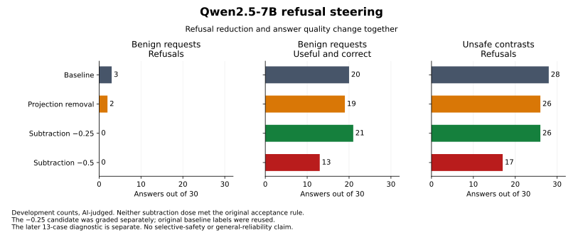

# tuneLLM

[Documentation website](https://renormalizationtech.github.io/tuneLLM/) ·
[Hugging Face artifacts](https://huggingface.co/RenormalizationTech) ·
[Figure and saved examples](docs/showcase.md) · [Reproduce](docs/reproduce.md) ·
[References](docs/references.md)

A reproducible LLM research portfolio covering **quantization, LoRA/QLoRA,
refusal steering and trait steering**. Experiments on Qwen3-4B and
Qwen2.5-7B-Instruct examine compression, adaptation and inference-time behavior
control, with explicit baselines and response-quality measurements. Mistral-7B-Instruct-v0.1
provides a SAPS reference; Qwen3.8-27B adds evaluated base exports and ongoing
scientific-task QLoRA training.

The goal is to demonstrate practical LLM research: implement methods, reproduce
results, compare alternatives and explain limitations. Positive effects, failed
transfers and quality tradeoffs are all retained. This is an experimental
portfolio; the results do not establish production-ready behavioral controls.

- Implemented model compression, domain-text QLoRA and activation interventions
  with pinned checkpoints, baseline comparisons and saved artifacts.
- Measured how stronger refusal/style steering can trade useful or coherent
  answers for a larger behavioral effect.
- Preserved unsuccessful transfers and quality failures alongside positive
  case-level findings, rather than selecting only successful outcomes.

## Results at a glance

| Area | What was implemented | Main measured result | Interpretation |
| --- | --- | --- | --- |
| Quantization (4B) | BF16 GGUF conversion; Q8_0/Q4_K_M quantization; saved NF4 base | GGUF weights: **7.50 → 3.99 → 2.33 GiB**; short A6000 generation benchmark: **79.1 → 130.5 → 186.0 tokens/s** | Compression and throughput gains in a fixed microbenchmark; capability checked separately on small subsets. |
| Physics QLoRA (4B) | NF4 frozen base, LoRA training on 100 licensed physics papers, checkpoint selection and reload | Held-out paper-text NLL **1.975 → 1.734**; GSM8K numeric **117/128 → 111/128**, strict-format correct **97/128 → 106/128** | Better fit and formatting alongside a numeric-accuracy regression; improved writing quality is unestablished. |
| Base formats (27B) | Saved NF4 and one Q4_K_M GGUF; local BF16-GGUF reference | [Fixed screen](results/qwen38_27b_quantization_screen_01.json): NF4/Q4 general MC **30/32 / 29/32**; numeric GSM8K **26/32 / 27/32**, strict **26/32 each** | Small workflow comparisons; NF4 lacks a same-backend BF16 control. Both public packages passed pinned-download/GPU-reload checks. |
| QASPER QLoRA (27B) | One epoch on 482 questions; selected checkpoint and prompt controls; all 403 final questions retained | [Primary Answer F1](results/qwen38_qasper_final_science_01.json), n=309: base **0.457**, selected prompt **0.567**, adapter **0.690**; lenient gains also pass | Fixed custom text-only task and retention gates pass; adapter published. This is not the full official benchmark. |
| PRL abstracts (27B) | 57 audited training papers; 40 fresh-to-project evaluation papers; two blinded AI passes | [Adapter preference](results/qwen38_prl_final_01.json) **0.175**, 95% paper CI **[0.075, 0.2875]**; retention gates pass | Abstract-quality gates fail despite lower NLL and higher reference overlap. Published as experimental; the base is preferred for this task. |
| Refusal steering | Contrastive direction extraction; constant subtraction versus projection removal on 4B/7B | 7B subtraction −0.5: unsafe refusals **28/30 → 17/30**, benign usefulness **20/30 → 13/30**. Selected benign diagnostic at −0.25: refusals **3/13 → 1/13**, useful valid full answers **9/13 → 11/13** | A causal intervention effect with dose/quality tradeoffs; the 13 selected cases are a narrow demonstration, not a general success rate. |
| Trait steering | Literature-based GCAD/SAPS references; random controls; model transfer; joint-control study | 7B GCAD sarcasm: **29/32** answers scored ≥50/100 versus **0/32** baseline; coherence **89.59 → 70.72**. Joint candidates passing all gates: **0/5** | Individual effects can be strong while quality and cross-trait coupling limit combined control. |

These rows use different tasks, models and evaluation designs. They are not a
single leaderboard. Behavioral scores use an AI judge; coherence does not imply
factual correctness. Detailed counts, controls, decoding limits and provenance
are linked below.



The same development prompts show the dose tradeoff. The later 13-case diagnostic
is separate. [Source counts, interpretation and saved examples](docs/showcase.md).

## Published artifacts

| Artifact | Contents | Start here |
| --- | --- | --- |
| [Qwen3-4B GGUF](https://huggingface.co/RenormalizationTech/Qwen3-4B-tuneLLM-GGUF) | BF16, Q8_0 and Q4_K_M weights, measurements and reproduction notes | [Quantization record](results/initial_quantization.json) |
| [Qwen3-4B NF4](https://huggingface.co/RenormalizationTech/Qwen3-4B-tuneLLM-NF4) | Saved unadapted bitsandbytes checkpoint with verified reload | [Model workflow](docs/model_workflow.md) |
| [Physics QLoRA](https://huggingface.co/RenormalizationTech/Qwen3-4B-tuneLLM-PRL-Writing-QLoRA) | Experimental adapter, prepared data, evaluation and reproduction package | [Physics study](docs/physics_prl_execution.md) |
| [7B trait-steering controls](https://huggingface.co/RenormalizationTech/qwen2.5-7b-gcad-steering-controls) | Profanity, impoliteness and sarcasm banks; standalone runtime; joint-study guide | [Four-behavior evidence](docs/steering_reference.md) |
| [7B refusal-steering experiment](https://huggingface.co/RenormalizationTech/qwen2.5-7b-refusal-steering-experiment) | Frozen refusal direction, inference runtime, experimental setting and results | [7B refusal study](docs/refusal_7b_transfer_execution.md) |

The refusal direction reduces refusal generally, including on unsafe contrasts;
it is not a benign-only refusal correction. The selected 13 cases came from
earlier 4B refusal cases, and the −0.25 diagnostic produced one repetitive output.

The steering releases contain activation interventions, not modified base-model
weights or LoRA adapters. Their base checkpoints must be obtained separately.
The earlier GSM8K adapter was archived and its HF repository deleted; its
[negative learning result](results/qlora_real_01.json) remains documented.

## Research questions and findings

**Compression:** what changes when the same checkpoint is represented in BF16,
Q8, Q4 or NF4? The [fixed-subset benchmark](docs/benchmark_summary.md) separates
accuracy measurements from size/speed tests. Backend and batching differences
limit cross-runtime timing comparisons; close scores do not prove equivalence.

**Adaptation:** does domain-text training improve the desired task? The physics
adapter reduced paper-text loss but did not establish improved scientific
writing. Numeric GSM8K accuracy fell 117→111/128 while strict-format correctness
rose 97→106/128; the two scorers measure different aspects of the answers. See the
[protocol](docs/physics_prl_protocol.md) and [results](results/physics_prl_final.json).

**Refusal control:** how do constant vector subtraction and projection removal
affect willingness and answer quality? The [method guide](docs/activation_steering_methods.md)
explains both interventions. Stronger subtraction reduced more refusals in our
fixed settings, while introducing quality costs. The original acceptance
criteria were not met; no confirmatory final/retention run followed the 7B
transfer. The later selected-case diagnostic preserves those decisions and
reports two useful rescues plus one repetitive output. See the
[execution record](docs/refusal_7b_transfer_execution.md).

**Trait control:** can an extracted representation induce sarcasm, impoliteness
or profanity while retaining coherent replies? Individual 7B references show
measured effects with different quality costs. Sarcasm narrowly passed its
coherence-loss criterion and also increased impoliteness. The
[joint study](docs/gcad_and_combined_control.md) found strong coupling and no
candidate passing every criterion. The [fixed 4B transfer](docs/qwen3_4b_fixed_transfer_closeout.md)
induced traits but failed quality gates; checkpoint differences do not isolate
a model-size effect.

## Reproduce and inspect

Start with a released artifact's model card and its pinned revisions; each
release documents its own environment. The training, GCAD and baseline
experiments used different dependency versions, so there is no single verified
environment for every track. The [reproduction guide](docs/reproduce.md) separates
portable CPU tests, pinned artifact replay and historical full-study runs.

| Track | Runnable entry point / reproduction guide |
| --- | --- |
| GGUF | [Released reproduction guide](https://huggingface.co/RenormalizationTech/Qwen3-4B-tuneLLM-GGUF/blob/main/REPRODUCE.md) |
| QLoRA | [Adapter reproduction guide](https://huggingface.co/RenormalizationTech/Qwen3-4B-tuneLLM-PRL-Writing-QLoRA/blob/main/REPRODUCE.md) and [training code](scripts/physics_train.py) |
| Refusal | Released `refusal_runtime.py` CLI; [original runbook](scripts/refusal_7b_benign_transfer_runbook.md) for historical context |
| Traits | Released `runtime.example` and joint guide; [sarcasm workflow](docs/sarcasm_controller_workflow.md) |
| 27B NF4 smoke | [Pinned profile](configs/qwen38_27b_nf4.json) and [local-only runner](scripts/qwen38_nf4_smoke.py); `--inspect` performs a CPU-only check before explicit GPU execution. |

For the original local 4B baseline, after the setup in
[the execution notes](docs/execution.md):

```bash
.venv/bin/python -m scripts.env_check --output outputs/environment.json
.venv/bin/python -m scripts.download_model --config configs/baseline.json
.venv/bin/python -m scripts.hf_baseline --output outputs/my-baseline
```

Historical runbooks document completed runs and may require preserved local
artifacts; they are not instructions to overwrite or repeat frozen studies.
The public test fixtures retain their historical held-out status only for the
reported runs. Future generalization studies need independent data.

## Qwen3.8-27B extension

The selected larger-model direction is **sarcasm steering, quantization and two
independent QLoRA adapters**. Reuse the existing methods, corpus and evaluation structure
where compatible; verify architecture/runtime support and resource needs first.
The official BF16 checkpoint has approximately 55.6 GB of weight files; an
NF4 copy is saved locally as described below. Quantized inference and QLoRA
use a smaller-memory path than the BF16 reference.
The initial **text-only Transformers NF4 load/save/reload smoke is complete**:
496 quantized linear layers, no missing language weights, no loaded vision
modules, and exact generated-token replay after a fresh-process reload on two
short prompts. Saved weights occupy **17.65 GB (16.44 GiB)**; peak PyTorch allocated memory
was **18.02 GB (16.78 GiB)** for this short run, not total device memory or a long-context
budget. See the [execution record](results/qwen38_27b_nf4_execution_01.json),
[smoke result](results/qwen38_27b_nf4_smoke_02.json) and
[local artifact hashes](results/qwen38_27b_nf4_artifact_01.json).

A strict cached/full-prefix numerical check failed on **one decode step**
(maximum logit difference 0.125), despite finite logits and matching argmax. Its tolerance and
failed result are preserved. All later compared arms must use the same cached
generation path and batch size; cache equivalence is unestablished. The smoke
used reference PyTorch kernels and does not measure broad quality or optimized
throughput. The subsequent evaluated 27B NF4 and Q4_K_M base packages are now
public; pinned anonymous full-file downloads and GPU reload checks passed.

The [27B evaluation and release plan](docs/qwen38_release_plan.md) now selects
**NF4 plus one Q4_K_M GGUF**, followed by separate **QASPER paper-QA/evidence**
and **PRL physics body-to-grounded-abstract** adapters, then evaluated Hugging
Face releases. The fixed NF4/Q4/BF16-GGUF comparison and development baselines
are complete. Both adapters finished training: 482 QASPER questions and 57 audited
PRL papers. The [locked PRL science evaluation](results/qwen38_prl_final_science_01.json)
failed its gates: AI-review preference favored the unadapted base. The adapter
is [published as experimental](releases/Qwen3.8-27B-tuneLLM-PRL-Abstract-QLoRA/README.md),
with complete retention and public reload verification. QASPER passed its fixed
text-only task and retention gates and is
[published](releases/Qwen3.8-27B-tuneLLM-QASPER-QLoRA/README.md). Its baseline
retains 395 original predictions plus eight first-time completions under a
prospective amendment; the original phase cap failure remains recorded. The
[preflight record](results/qwen38_science_preflight_01.json) separates mechanics
from quality evidence. Sarcasm transfer is deferred to reserve GPU capacity.
Report each intervention against its own baseline.
ARA, broad parameter sweeps, joint-controller retuning and production deployment
are deferred.

The [27B closeout report](results/qwen38_science_summary_01.json) records all four
public releases, final outcomes and settled budgets. The results and release
cards include reproduction and verification evidence. The
[portfolio summary](docs/showcase.md#qwen38-27b-portfolio-summary) includes CV
bullets and interview wording grounded in these results. See
[workspace maintenance](docs/workspace_maintenance.md) for the scoped cache
cleanup and retained experiment evidence.

See [the current roadmap](docs/project_tracks.md), [model workflow](docs/model_workflow.md)
and [release index](releases/README.md). Older protocol documents remain as
records of the experiments as registered; current priorities supersede their
pending-expansion language.

## Repository layout

Use the [file organization and storage rules](docs/file_organization.md) when
adding runs, results, model assets or releases.

| Location | Purpose |
| --- | --- |
| [docs/](docs/index.md) | Current guides and historical experiment records; [project status](docs/project_tracks.md) is authoritative. |
| [scripts/](scripts/README.md) | Runnable entry points, shared modules and historical runbooks. |
| [configs/](configs/README.md) / [evaluation/](evaluation/README.md) | Pinned experiment settings, scoring code, prompts and rubrics. |
| [results/](results/README.md) | Compact outcomes, registered protocol bindings, reviews and publication receipts. |
| [releases/](releases/README.md) | Nine current HF card mirrors, a release catalog and historical metadata; model weights are not stored here. |
| `artifacts/`, `outputs/`, `.hf/` | Ignored local models/release payloads, raw run evidence and download caches. |
| `data/` | Mostly ignored corpora; selected small steering fixtures and license records remain tracked. |
| [tests/](tests/conftest.py), `requirements*.txt` | Portable CPU checks plus opt-in research checks, and separate environment profiles. |

Historical file paths are retained where protocols and source hashes depend on
them. [plan.md](plan.md) and [release history](releases/HISTORY.md) are context,
not current task lists. Start new work from the roadmap and reproduction guide.

## Implementation and attribution

**Project ownership:** the project owner directs the research questions,
model/method priorities and scope, reviews result interpretation, and decides
which demonstrations and releases serve the portfolio goal. Codex wrote and
executed the implementation and experimental runs under the owner's direction;
Claude supplied scientific review and the disclosed AI-judge evaluations.
This is an AI-assisted research project applying existing methods.

Python, PyTorch, Transformers, PEFT, bitsandbytes, llama.cpp and Hugging Face Hub
support the workflows. Protocols, configurations and compact results live in
`docs/`, `configs/` and `results/`; scripts and evaluation fixtures accompany
them. Weights, caches and large raw outputs remain in ignored directories.
Source and dataset attribution are recorded per experiment and release.
The [third-party notices](THIRD_PARTY_NOTICES.md) distinguish original code from
copied code, data and paper-derived rubric terms. [References](docs/references.md)
identify the methods applied here.

For a short review: this overview → [figure/examples](docs/showcase.md) →
[four-behavior evidence](docs/steering_reference.md) →
[7B execution details](docs/refusal_7b_transfer_execution.md).
[plan.md](plan.md) is historical planning context; the
[current roadmap](docs/project_tracks.md) records active priorities.
