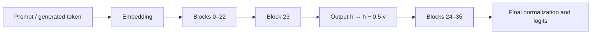
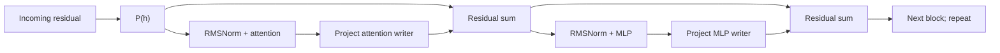

# How the two refusal-steering approaches work

[Refusal-steering background](refusal_foundations.md) defines contrastive
directions, coefficient units, projection geometry and
the distinction between a mechanical intervention and a behavioral claim.

This explains the two intervention families used in run 03. Both alter
activations during inference on the unmodified upstream BF16 Qwen3-4B
checkpoint. No LoRA adapter was loaded, no gradient update was performed, and
no model weights were edited.

## Shared setup and notation

The model has 36 decoder blocks and hidden size 2,560. A token's residual
activation is a vector \(h \in \mathbb{R}^{2560}\); a batch of activations has
shape [batch, token positions, 2560].

**Our block numbers are zero-based.** “Block 23” means
`model.model.layers[23]`, the 24th block. Its output is the residual entering
block 24.

We extracted separate contrast directions at diagnostic blocks 11, 17 and 23 from
100 AdvBench instructions and 100 context-free Dolly instructions:

\[
v_\ell =
\operatorname{mean}(h_\ell \mid \text{AdvBench})
-
\operatorname{mean}(h_\ell \mid \text{Dolly}).
\]

Extraction captured the last real prompt token after the nonthinking generation
prefix. Run 03 reused **the block-23 vector** for both methods. The all-block
method did not use 36 separately fitted vectors.

Write \(v = v_{23}\) and \(u=v/\|v\|\). The saved raw vector has norm about
61.19; \(u\) has unit norm. This is a source-class mean difference, which may
include topic or wording differences as well as refusal-related information.
“Refusal direction” is a convenient hypothesis, not a guarantee of a pure
behavioral feature.

## Approach 1: a fixed shift at one block

General activation addition is

\[
h'_{\ell,t}=h_{\ell,t}+\alpha v_\ell.
\]

The vector is fixed during a run; the activation \(h_{\ell,t}\) changes with
the prompt and token. The sign and size of \(\alpha\) determine the displacement.
Later blocks then process the changed activation.

Run 03 used the fixed condition `subtract23`:

\[
\boxed{h'_{23,t}=h_{23,t}-0.5v.}
\]

This is one forward hook at **block 23's output**, at every token position:
all prompt tokens during prefill and each new token during cached decoding.
It includes padding positions, which remain masked from real-token attention.

The raw vector is not normalized for this operation. The shift has norm
\(0.5\|v\|\approx30.60\), about 30% of the median last-prompt-token activation
norm in our extraction data. That is not a uniform 30% change for every token.

A constant shift always moves along the same direction, even if the current
activation already has little or negative projection onto \(u\). The shift
can therefore move a benign state farther from its original distribution.
Whether this explains our quality loss remains a diagnostic question.

There is no repeated addition of the vector to the *same* stored token state.
Instead, the chosen block modifies each token activation as inference processes
it. Generated tokens and cached representations also influence later decoding.

## Approach 2: remove the current projection across all blocks

Define the projection-removal operator

\[
P(x)=(I-uu^\top)x=x-u(u^\top x).
\]

The condition `ablate_all` applies this operation throughout the residual
stream. Unlike fixed subtraction, its displacement depends on the current
activation: it removes the component that is actually present along \(u\),
whatever its sign or magnitude.

We implement three intervention sites per block:

1. The residual entering the block.
2. The attention residual writer, `block.self_attn.o_proj`.
3. The MLP residual writer, `block.mlp.down_proj`.

There are **108 intervention sites across 36 blocks**. In exact arithmetic,
projecting the incoming residual and both writer contributions makes the
post-attention and post-MLP residual sums orthogonal to \(u\). For example,

\[
h_0=P(h),\qquad
h_{\rm mid}=h_0+P(a(h_0)),\qquad
h_{\rm out}=h_{\rm mid}+P(m(h_{\rm mid})),
\]

where \(a\) and \(m\) include their respective normalization and computation.
The same \(u\) is used at every site. In exact arithmetic, the next block's
input is already orthogonal after the previous residual sum; the later input
projections also remove residual components introduced by numerical rounding.

Projection arithmetic is FP32 and outputs are cast back to BF16, so numerical
orthogonality is approximate. Q/K/V states, the final normalization and logits
are not directly projected. This is runtime activation editing, rather than
a permanent weight-orthogonalization edit.

The mechanical probe also observed mid/post residuals without changing them.
Those 72 additional observation nodes explain the **180 observed nodes** in
the audit; only 108 sites performed interventions.

## Why subtraction and projection removal differ

Consider a two-dimensional illustration with \(v=(2,0)\), \(u=(1,0)\) and
\(\alpha=-0.5\):

| Original activation | Fixed subtraction \(h-0.5v\) | Projection removal \(P(h)\) |
| --- | --- | --- |
| \((3,4)\) | \((2,4)\) | \((0,4)\) |
| \((-3,4)\) | \((-4,4)\) | \((0,4)\) |

Subtraction translates both points in the same direction. Projection removal
moves each point to the subspace orthogonal to \(u\). Normalizing a vector is
not itself a quality improvement: subtracting \(0.5v\) is exactly the same
displacement as subtracting \(0.5\|v\|u\). A coefficient must be interpreted
together with the vector's normalization.

| Property | `subtract23` | `ablate_all` |
| --- | --- | --- |
| Operation | Fixed additive displacement | Remove the current projection |
| Direction representation | Raw \(v\) | Unit \(u\) |
| Setting tested | \(\alpha=-0.5\) | Full removal |
| Magnitude | Constant per token | Depends on the activation |
| Block coverage | Output of block 23 | All 36 blocks |
| Intervention sites | 1 | 108 |
| Token coverage in run 03 | All prompt/generated positions | All prompt/generated positions |
| Weights changed | No | No |

The current implementation fixes these settings. It does not expose a
coefficient sweep as part of the completed run.

## Runtime implementation and verification

The context manager `intervene` in
[reduction_hooks.py](../scripts/reduction_hooks.py) installs and removes the
hooks. For example, a generation or scoring call can execute inside either
`intervene(model, "subtract23", vector)` or
`intervene(model, "ablate_all", vector)`. The staged
[runner](../scripts/refusal_reduction.py) and
[runbook](../scripts/refusal_reduction_runbook.md) contain the exact experiment
settings and artifact guards.

The code caches FP32 directions once per activation device, restores each
activation's dtype, preserves module output structures, and removes hooks
even on exceptions. Direction tensors are cached only within the intervention context. Separately,
the runner does not pass a generation KV cache between batches or conditions.

The 26 new CPU checks included actual tiny-Qwen3 cached/full-prefix comparisons,
projection algebra, all-block writer coverage, identity behavior, cleanup,
selection and provenance guards. On the real model, identity interventions
matched baseline tokens and logits exactly. Nonzero interventions changed
hidden states/logits, and plain logits matched again after hook cleanup.

These checks establish implementation mechanics, not behavioral usefulness.

## How this relates to earlier runs and the literature

Activation addition is an established steering family. CAA uses contrastive
activations and adds a direction at a selected layer during generation.
Arditi et al. used single-layer addition to induce refusal and all-layer
directional ablation to reduce it. Their Appendix I also compares negative
activation addition with ablation. These papers motivate the method families;
our data, selection and placement are not a full replication of either paper.

- [CAA paper: method and layer experiments](https://arxiv.org/html/2312.06681v4)
- [Refusal-direction paper: interventions and Appendix I](https://arxiv.org/html/2406.11717v3)

Our earlier positive pilots used addition at block 17 or 23, affecting only
the last real prompt token during prefill and each generated token. Run 03
changed both reduction methods to **all-token scope**. Its subtraction is at
the block output; the cited refusal paper describes addition at the layer input.

Run 03 compared two strategies that differ in operation, coverage and effective
perturbation magnitude. It does not isolate a pure block-choice effect, show
that later blocks are always better, or prove that all-block intervention is
inferior.

## What the comparison established

| Development metric | Baseline | Fixed subtraction | All-block projection removal |
| --- | ---: | ---: | ---: |
| Valid answers, source-unsafe prompts | 2/30 | 8/30 | 6/30 |
| Useful/correct, safe prompts | 11/30 | 10/30 | 13/30 |

The fixed rule selected subtraction. Only that method was evaluated against
a freshly generated baseline on the final set. Valid answers on the
refusal-triggering class increased from 1/30 to 7/30, while safe usefulness
fell from 29/42 to 23/42 and three candidate outputs had mechanical degeneration
flags. Final quality criteria failed. Projection removal has no final result
in this study.

See the [execution record](refusal_reduction_execution.md),
[compact result](../results/refusal_reduction_summary_03.json), and
[stored-output diagnostic protocol](refusal_output_diagnosis_protocol.md).
The diagnosis preserves the original results and determines what uncertainty
a future study should address.
