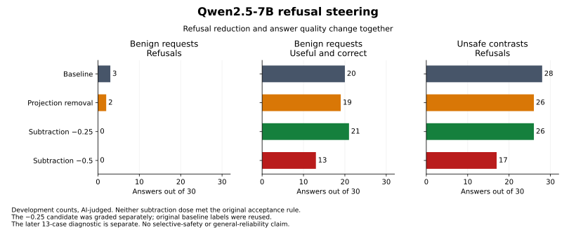

# tuneLLM research documentation

**Quantization, LoRA/QLoRA and activation steering of open-source language models.**

tuneLLM is an AI-assisted research portfolio studying compression, domain
adaptation, refusal and written traits. The experiments compare interventions
against fixed baselines and report quality costs, unsuccessful transfers and
retained experimental references together.

## Find what you need

| Destination | Contents |
| --- | --- |
| [Short demonstration](short_demonstration.md) | A four-minute recorded comparison of QASPER adaptation and tunable sarcasm; no GPU needed. |
| [Results and portfolio](showcase.md) | Main findings, CV bullets, interview summary and saved examples. |
| Quantization | [4B measurements](benchmark_summary.md) and [27B NF4/Q4_K_M results](qwen38_quantization_results.md). |
| LoRA and QLoRA | [4B physics results](physics_prl_execution.md), [27B QASPER/PRL adapters](qwen38_qlora_results.md), and [Gemma 4 31B QASPER](gemma4_qasper_results.md). |
| [Release catalog](../releases/README.md) | All ten public packages, model cards and pinned Hugging Face revisions. |
| [Reproduce](reproduce.md) | CPU checks, loading instructions and separate runtime environments. |
| [Project status](project_tracks.md) | Completed work and deferred studies. |
| [Theoretical background](learning_foundations.md) | Formulations, assumptions and primary references underlying the methods and implementation choices. |

Use the left sidebar to switch topics, its search box to find a term, and
**On this page** to jump between headings. On a phone, open **Menu** for the
same site navigation. Historical protocols are under **Research archive**;
they remain searchable and keep their original URLs.

Start with the [results and saved examples](showcase.md), then use the
[reproduction guide](reproduce.md) to inspect an artifact or run the portable
CPU checks. [GitHub](https://github.com/RenormalizationTech/tuneLLM) contains the
code and compact results; [Hugging Face](https://huggingface.co/RenormalizationTech)
hosts ten published artifacts, including the evaluated 27B NF4 and Q4_K_M bases.

## Research tracks

| Track | Question | Main evidence |
| --- | --- | --- |
| Quantization | What changes when a model is compressed? | [4B fixed-subset comparisons](benchmark_summary.md) and [27B NF4/Q4_K_M screen](qwen38_quantization_results.md). |
| LoRA and QLoRA | Does adaptation improve the task beyond prompting, and what else changes? | [4B physics training](physics_prl_execution.md); [27B QASPER gain and PRL quality failure](qwen38_qlora_results.md), with fixed task and retention checks. |
| Refusal steering | How do subtraction and projection affect willingness and usefulness? | A dose/quality tradeoff and a selected benign case demonstration; [7B execution record](refusal_7b_transfer_execution.md). |
| Trait steering | Can internal interventions change style while preserving coherent answers? | GCAD/SAPS references with quality costs and coupling; [consolidated evidence](steering_reference.md). |

The figure separates refusal reduction from answer usefulness. These are
AI-judged development counts; the weaker-dose candidate was graded in a separate
packet from the reused baseline. The later selected-case diagnostic is a
separate result. [Figure data, interpretation and examples](showcase.md).

## Suggested reading { #a-short-reading-path }

1. [Results and examples](showcase.md): the main tradeoff and two selected saved responses.
2. [Activation steering methods](activation_steering_methods.md): the intervention equations and implementation choices.
3. [Four-behavior evidence](steering_reference.md): model-specific results, controls and limits.
4. [Reproduce](reproduce.md): portable CPU tests, pinned inference bundles and separate environments.
5. [Methods and references](references.md): published approaches and source attribution.
6. [File organization and storage rules](file_organization.md): where new files belong and how history is retained.

## Published artifacts

- [Qwen3-4B GGUF](https://huggingface.co/RenormalizationTech/Qwen3-4B-tuneLLM-GGUF): BF16, Q8_0 and Q4_K_M inference representations.
- [Qwen3-4B NF4 base](https://huggingface.co/RenormalizationTech/Qwen3-4B-tuneLLM-NF4): saved unadapted quantized base and reload checks.
- [Physics QLoRA adapter](https://huggingface.co/RenormalizationTech/Qwen3-4B-tuneLLM-PRL-Writing-QLoRA): experimental domain-text training with evaluation and prepared data.
- [7B trait controls](https://huggingface.co/RenormalizationTech/qwen2.5-7b-gcad-steering-controls): activation banks and a standalone runtime.
- [7B refusal experiment](https://huggingface.co/RenormalizationTech/qwen2.5-7b-refusal-steering-experiment): frozen direction, runtime and selected-case findings.

The [release index](../releases/README.md) records current HF revisions and local
card/payload locations. Steering bundles use separately obtained upstream base
weights; they are distinct from LoRA adapters.

## Current scope and historical records

The planned 4B, 7B and text-only 27B work is complete. Ten packages are public,
including five Qwen3.8 releases. Detailed benchmarks and methods live under
**Quantization**, **LoRA and QLoRA**, **Refusal steering** and **Trait steering**.
The [results overview](showcase.md) summarizes the findings; the
[release catalog](../releases/README.md) lists the artifacts.

QASPER passed its custom-subset task and retention gates; PRL failed abstract
quality and remains experimental. Stronger 27B GCAD induced sarcasm with
coherence costs, but no strength passed every gate. Both sarcasm outcomes remain
unchanged: `development_null` and `exploratory_null_through_b16`. The
[tunable controls](qwen38_sarcasm_release.md) are an experimental demonstration.
The [project status](project_tracks.md) and
[final 27B closeout](../results/qwen38_project_closeout_02.json) retain the
completed scope and unchanged outcomes.

The separate [Gemma 4 31B QASPER study](gemma4_qasper_results.md) is complete and
passes its registered task and retention gates. Lenient Answer F1 improved from
0.334 to 0.640; the strict baseline was a format floor. Its adapter release is
being verified. Gemma PRL remains a separate next decision.

All Markdown documents under `docs/` are available through this site. Protocols,
closeouts and execution notes preserve their historical decisions and wording;
they are not all current setup instructions. Raw run directories and machine
paths mentioned there may require retained local artifacts. Use the current
reproduction guide for the public entry points.

For source and data terms, read [third-party notices](../THIRD_PARTY_NOTICES.md).
The [project README](../README.md#implementation-and-attribution) describes the
owner's direction and the roles of Codex and Claude.
