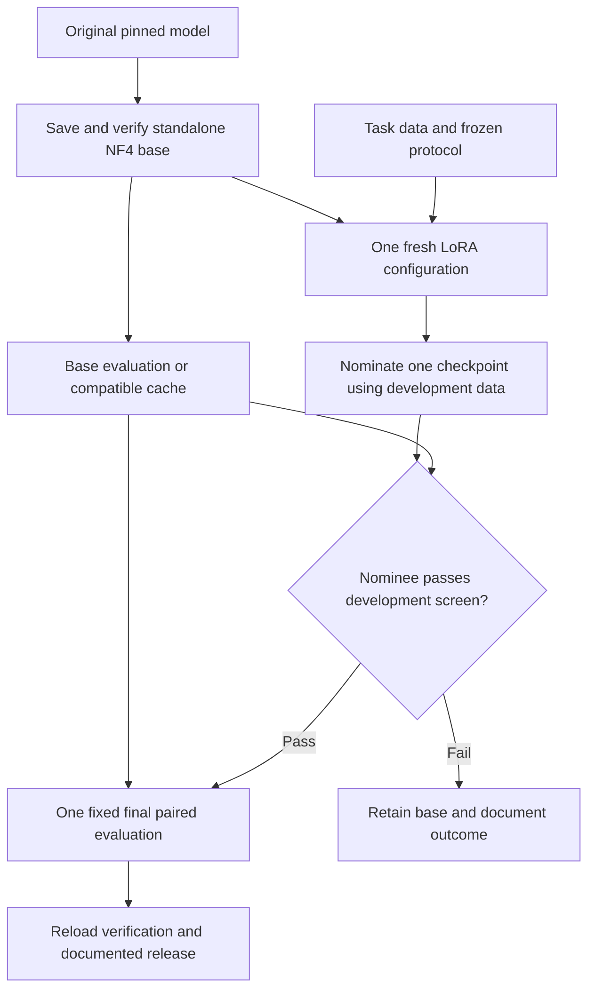

# Reusable model adaptation workflow

Agreed with the user on 2026-11-12. The first implementation uses the pinned
Qwen/Qwen3-4B checkpoint. Learning quantization and fine-tuning remains the main
project goal; scientific-writing gains are an experimental outcome, not assumed.
The routine policy below was updated after the calibration pilot and reviewed
with Claude following the user's workflow discussion.

Current publication status (2026-11-16): the NF4 base and PRL Writing QLoRA
adapter are public. The GSM8K adapter repository was deleted after verifying an
ignored archive of all three reachable revisions (42 file entries). See the
[transition receipt](../results/hf_visibility_transition_01.json) and
[release index](../releases/README.md). The fixed7B joint study/guide is also
complete and [publicly verified](../results/steering_publication_joint_04.json):
all12 arms measured,0/5 combined candidates qualified; strong coupling and
coherence costs remain visible. Friendly-PF scores are distinct from the
separate post-hoc literal lexical audit. The [DECCP7B baseline](deccp_headroom_closeout.md)
is also complete and did not meet prespecified headroom criteria: English
1 refusal+7 evasions/36, controls0/11; Chinese0+5/11 is descriptive only. Grader-classified
evasion has a subjective boundary and is distinct from explicit refusal; this did not score missing facts or
accuracy. No intervention/refusal model followed that DECCP screen; its 25
held-out rows remain ungenerated. A separate conventional 7B subtraction study
subsequently completed and its [experimental direction/runtime](https://huggingface.co/RenormalizationTech/qwen2.5-7b-refusal-steering-experiment)
is public, with the original nulls and selected-case limits preserved. See the
[current release index](../releases/README.md). Qwen3-14B remains historical only.
The official Qwen3.8-27B text-only NF4 load/save/reload smoke is complete;
sarcasm steering and physics QLoRA remain planned. The
[reproduction guide](reproduce.md) separates environments and portable checks
from historical artifact-dependent workflows.

## Scope: adapter training and behavioral research

This workflow's training steps cover quantization and LoRA/QLoRA learning.
The physics corpus is a demonstration dataset for training, saving, reloading
and evaluating an adapter. It is independent of the behavioral program:
refusal activation steering, followed by persona/tone research.

Persona prompting changes inference-time instructions and supplies a reference
for desired written behavior. Persona activation steering changes hidden states
during inference. Neither trains the physics adapter. P1 used the unadapted
BF16 base; its physics/math questions checked content retention, not PRL writing
or physics-adapter improvement. See the [project map](project_tracks.md) for
methods, completed status and the user-selected profanity/rudeness/sarcasm
objective: isolated controls first on 4B, then a separate simultaneous study.
The fixed 4B transfer is complete. Future model options are Qwen3.8-27B and
Gemma 4; Qwen3-14B is retained as historical evidence, not a future target.

## Routine workflow after the calibration pilot

The completed physics experiment explored multiple settings. The routine path
uses one verified base and one fresh adapter configuration per task:

1. Define the target behavior, dataset, splits and success measures. Use raw text
   for domain-language exposure; use instruction/response pairs for task behavior.
2. Pin the model, tokenizer, software, data and inference settings. Save and
   verify the standalone NF4 base before attaching an adapter.
3. Evaluate the unadapted base on development inputs, or reuse compatible cached
   baseline results.
4. Register one task-appropriate rank, LR and schedule, with seed 42 as the
   reproducible default. Inspect a decoded training batch and loss mask first.
5. Train the fresh adapter and nominate one checkpoint using a registered
   development criterion (loss, or a bounded task metric). Run the full small
   development screen on that nominee only. If it fails the registered gates,
   retain the base; a changed configuration belongs to a new experiment.
6. For a passing nominee, fix the checkpoint, then evaluate the base and selected
   adapter once on the final set. Preserve regressions and uncertainty alongside
   task gains.
7. Verify reload, document the result, and release the selected experimental
   artifact with the explicitly chosen visibility after license/payload review.

Baseline reuse requires matching weights/quantization, tokenizer/chat template,
fixture and prompt hashes, inference/scorer code hashes and package versions,
backend/dtype, generation
settings, batching and compatible hardware. A cached accuracy result does not
provide a new hardware/runtime measurement.

Rank/LR grids, extra seeds, a BF16 LoRA control and full GGUF comparisons are
optional calibration investigations. Register them when the question requires
them; they are not steps in every routine adapter run. If comparing BF16 and
NF4 adaptation, retain each representation's own unadapted reference.

The physics choice of rank 128, LR 5e-5 and seed 42 belongs to that model/corpus
experiment. A new task gets its own declared configuration. Adapter storage of
1–5 GB is an upper allowance, not a minimum target.

The original learning milestone is complete, including GSM8K instruction tuning.
Another [task-specific instruction-tuning exercise](next_sft_pilot.md) is optional
backlog. Reporting, the early tone-construction attempts and refusal studies
have completed; [persona P1](persona_prompt_execution.md) was a separate
prompt-only reference and did not validate an activation-steering configuration.
The behavioral track tests profanity, rudeness and sarcasm individually on 4B,
then considers simultaneous controls as described in
[the roadmap](project_tracks.md). The bounded rating calibration passed, and the
[profanity pilot closed with a development null](profanity_steering_execution.md).
The separately registered [rudeness and sarcasm pilots](isolated_persona_traits_execution.md)
also closed with development nulls, after accepted fixtures/code and 16 passing
CPU checks. A null closes its registered study without validating that control.
Those historical pilots did not establish quality-preserving 4B control;
the later fixed4B transfer also qualified no controller. The user selected the [literature-first isolated workflow](persona_literature_workflow.md).
New steering tasks first audit successful author code/data and establish a
bounded method adaptation before custom changes. Consolidate each isolated
workflow after its result. One separately registered7B joint study is now
complete with no qualifying combined candidate; no further tuning follows automatically. Rudeness and profanity PV
grids closed with nulls. SAPS sarcasm passed its registered paraphrase reference
and compact capability checks, with reduced meaning preservation; this is not
generic persona control. See the [completed execution record](persona_reference_execution.md).
Steering changes activations during inference;
the routine adapter-training steps above apply only when a new training exercise
is explicitly selected. Review management plans with Claude first and delegate
code implementation to the worker.

## Artifact lineage

Preserve the upstream repository, immutable revision, tokenizer, license, package
versions and checksums. Large artifacts, datasets and raw outputs remain under
git-ignored `artifacts/`, `data/`, `outputs/` and `.hf/`.
See [workspace maintenance](workspace_maintenance.md) for retention and cleanup.

The [2026-11-16 cleanup receipt](../results/storage_cleanup_20261116_01.json)
records removal of redundant verification caches, duplicate pre-review adapter
weights and 14B/Mistral weight blobs. All physics optimizer states and
checkpoints were retained. These two model caches are intentionally partial:
tokenizers/configs/indices/refs remain, and no weight links dangle. Metadata
backups and revision-pinned recovery instructions are under
`outputs/storage-cleanup-20261116-01/`; old reports can name cache paths whose
weights are now absent. Recovery is not an automatic download instruction.

For a new model's quantization calibration, produce independent branches directly
from the original high-precision weights. Routine adapter runs reuse the verified
NF4 branch and matching baseline:

1. BF16 reference checkpoint.
2. GGUF Q8_0 and Q4_K_M for inference. Keep the existing BF16 GGUF reference.
3. bitsandbytes NF4 with double quantization and BF16 compute for QLoRA.

Do not cascade one lossy quantization into another. Save the standalone NF4 base
and tokenizer **before** attaching LoRA. Reload it and verify packed tensors,
quantization metadata, logits and deterministic generation. Record preparation
of unquantized parameters (our PEFT preparation casts them to FP32). Every adapter
must identify the exact saved base and its quantization settings.

## Completed physics-style pilot; assessment deferred

The user wants physics writing to remain a lightweight exercise in learning the
rough PRL language and structure. Further physics training and writing-quality
assessment are deferred. The completed learning/release milestone is not blocked
on human ratings. Later Claude/Codex reviews will be labeled AI judgments; human
review is optional. Existing results retain their actual unrated status.

The core purpose of this branch is to show that we can fine-tune with LoRA/QLoRA
on physics data. Its training objective and experimental adapter remain separate
from persona prompting, emotional tone and inference-time activation steering.

The pilot collected 100 PRL-associated condensed-matter **theory** papers,
balancing topics rather than selecting one subfield. Publication associations
were checked through DOI/Crossref metadata; arXiv versions, licenses and source
URLs were recorded.
An arXiv category alone does not establish that a paper is theoretical. Favor
sources with clear reuse permission; a mirrored dataset does not override each
paper's license. Record any shortfall instead of silently changing eligibility.

Prefer LaTeX sources, preserving prose, equations and section structure. Remove
comments, unused files, author/affiliation details, acknowledgments, templates,
publication-status boilerplate and journal labels. Keep attribution and DOI in
the separate provenance manifest. Treat papers and their versions as a single
group for splitting; related duplicates must not cross train/dev/test boundaries.

The first training objective is causal next-token prediction on cleaned paper
text, including its scientific prose and LaTeX. This is domain-adaptive continued
training with LoRA, not the previous GSM8K assistant-only supervised objective.
Measure and report actual token counts. Do not assume 100 papers improve general
physics reasoning or implement a mapping from PRB manuscripts to PRL acceptance.

Writing tasks cover titles, abstracts and introductions. Titles came from arXiv
metadata, abstracts from LaTeX abstract environments, and introductory passages
from the first opening blocks (up to four, stopping after roughly 2,200
characters). The introduction boundary is heuristic, not manually annotated.
Training used cleaned main-paper text. Evaluation prompts used body evidence
excluding those reference passages. Later editing SFT needs reviewed
input/revision pairs and is a separate experiment.

Raw sources and license checks are in `data/physics-prl-01/raw/sources/`.
Prepared papers and extracted fields are in `train.jsonl`, `validation.jsonl`
and `test.jsonl` under `data/physics-prl-01/` (70/10/20 papers). Writing fixtures
are under `data/benchmark-screen-01/`; model responses are under
`outputs/physics-final-screen-*/writing_predictions.json`. These large/generated
folders remain Git-ignored. Exact prepared splits are also in the now-public
release's `reproduction_data/` folder. The historical test measurements remain
as reported, but disclosed test data and fixtures cannot provide clean future
held-out evaluation.

## Calibration history and checkpoint selection

The completed physics calibration compared all-linear ranks 8, 32 and 128 with
equal maximum exposure. A rank-32 LR pilot compared 5e-5 and 1e-4; the lower LR
was retained. Rank 128, LR 5e-5, seed 42, epoch 1 / step 69 was selected by the
registered development rule. The six training runs comprised four optimization
candidates, one seed-43 repeat and one BF16 control, not six different seeds.

Each run completed a three-epoch schedule, with development loss after every
epoch. The rule nominated the minimum-loss epoch
(ties prefer earlier), then applied capability/writing gates to that epoch only;
no alternate-epoch search followed a gate failure. The repeat and BF16 control
used the selected configuration and full scheduler horizon, and were compared at
the primary chosen epoch. See [the execution record](physics_prl_execution.md).

The selected epoch-1 checkpoint was trained within a three-epoch LR schedule.
Setting a fresh run to `epochs=1` changes the decay trajectory and does not
reproduce that checkpoint. Record maximum steps/epochs, warmup, decay, validation
intervals, stopping rules and selected exposure explicitly in every new protocol.

Freeze source, data IDs/hashes, splitting, development selection rules and final
test protocol before optimization. Use task-specific development metrics and
retention checks alongside the registered checkpoint criterion. Lower paper loss measures better
fit to the register; it is not proof of better writing. Never select on final-test
outputs. Preserve an unadapted base as a valid outcome if adapters fail checks.

## Evaluation tiers

Prefer a pinned standard harness for supported tasks, especially answer-likelihood
scoring for multiple-choice tasks. This pilot uses a validated custom local
zero-shot MMLU likelihood runner and the pinned official IFEval scorer; report that
scope explicitly. Validate identical prompts, tokenizer/chat
templates, thinking settings, scoring and budgets across backends. Do not present
custom generated-letter accuracy as the standard likelihood benchmark.

- Development screen: roughly 140–150 items. The physics pilot used 32 general
  MMLU, 32 physics MMLU, 32 GSM8K, 16 IFEval and 30 writing tasks (142 total).
  A new task replaces the task-specific block and declares its metrics before
  training. This screen catches large failures and informs selection.
- Final evaluation: one base-versus-selected-adapter comparison after choices are
  fixed, using separate test examples and a declared task/retention budget. The
  physics pilot used 444 items per full HF condition. Choose the new task's final
  budget after a short development timing trial and before optimization.
- Extended comparisons: extra representations, precision controls, seeds or a
  few-shot writing reference only when answering a registered question.

In the completed calibration, development evaluation used 710 task items
(112 base + 30 few-shot writing + four candidates × 142). Final evaluation used
2,988 items (four HF conditions × 444 + 60 few-shot writing + three GGUFs × 384).
The eight final conditions were inference setups, not eight training runs.
Recorded costs were about 2h10m for six training runs, 1h06m for development
screens and 1h41m for final screens. Per-epoch development paper-loss checks are
included in training time; generation screens are counted separately. These
totals exclude acquisition, implementation/review and publication overhead.

Existing physics sets include MMLU college/high-school/conceptual physics and
SciBench. They are retention checks for this writing project. Keep development
and final-test items separate, including when splitting a labeled validation set.
Report per-task results, paired differences, uncertainty, invalid outputs and
truncation; do not hide regressions in a single mean.

When writing assessment resumes, use held-out papers and compare responses
generated from the same source evidence. Check scientific fidelity
(claims, equations, numbers and citations), clarity, concision, organization,
accessibility and supported framing of significance. Preserve paired outputs in
randomized, blinded review packets. Automatic checks and model ratings are
diagnostics; human preference is pending until actual human review occurs.
AI ratings must identify the judge, rubric, prompt version and compared
conditions, preferably with blinded A/B identities. The existing review packets
remain available; no new ratings are required now. Held-out token-weighted loss
is a separate objective metric and does not establish better writing.

Budget evaluations in prompt/output tokens and measure throughput on each model.
Small screens have substantial statistical uncertainty. A larger model can also
be limited by memory and offloading; do not extrapolate runtime from parameter
count alone.

Compare BF16 LoRA with an unadapted BF16 baseline, and NF4 LoRA with the saved
unadapted NF4 baseline. Compare GGUF quantization within the same llama.cpp
backend, retaining its BF16 GGUF reference. A cross-backend difference cannot be
attributed to quantization alone.

## Completion and release

Verify adapter serialization and regeneration on a freshly reloaded saved base.
Report the registered configuration and any registered controls, exceptions,
actual time/memory, and limits.
Review concrete model cards, data-license compatibility and the explicitly
chosen visibility before any new upload. NF4 and PRL Writing QLoRA are now
public; historical private labels in receipts and reproduction notes remain
unchanged. The PRL dependency stays pinned to NF4 revision
`e9af208e44e083b77702a71d8aa65b7d97f78ce6`, not the newer card commit.
The transition verified anonymous pinned access through small-file downloads
and large-file LFS metadata against prior verified hashes, with no new weight
download or GPU check. Only cards changed; weights and other file identities
were preserved. The archived GSM8K negative result remains part of the learning
record after its repository's deletion. New releases do not overwrite historical
receipts, protocols or execution reports.

Better PRL-like presentation cannot establish novelty, publication suitability
or acceptance. A negative or inconclusive experiment is still a completed,
reproducible learning exercise when reported honestly.

## Applying the process to another model

The methodology is reusable; the first experiment's release and orchestration
helpers contain Qwen3-4B paths, repository pins and file-layout checks. For a new
model, update those guards alongside the model configuration and register fresh
protocols. The current 12-file NF4 manifest check is specific to this checkpoint.

Verify tokenizer boundaries and saved-quantization reload first. Estimate adapter
parameters and memory from the new architecture. Freeze the data splits, then
time training on training examples and generation on development prompts; discard
preflight adapters and start the actual run fresh. Use those observed
token rates to budget the screen; retain small development checks for every
candidate and broader final tests only for the chosen adapter and any registered
controls.
Recheck the model/data licenses and converter support for the newly pinned model.

## AI evaluation runtime

For AI evaluation, pin the actual CLI executable before the isolation audit and
record its version and SHA-256 alongside wrapper/argv/rubric/payload hashes.
Use that same binary resolution for the version guard and every grading call;
an automatically updated default command is not a stable runtime dependency.
Keep any command pin local to the evaluation process. A local guard failure
before a remote call should retain its log and require a documented coordinator
review before resumption. Do not replace responses, change grading criteria or
hide the failure. Record exposed server-side model IDs and disclose when a
dated model snapshot is unavailable. See the
[Phase A runtime incident](benign_helpfulness_execution.md#grading-runtime-incident).

## Optional inference-time activation-steering research

Activation steering is a separate branch from quantization and adapter training.
The [two-method guide](activation_steering_methods.md) defines the fixed vector
shift and all-block projection-removal approaches used on Qwen3-4B.

Before another steering run, diagnose existing regressions using stored outputs
when possible. The [run-03 diagnosis](refusal_output_diagnosis.md) illustrates
why cap hits alone cannot explain quality loss. A baseline quality screen
should usually let its answers finish, and willingness to answer must remain
separate from task completion, grounded correctness and repetition.

Choose layer, direction, token scope, normalization and actual perturbation
strength explicitly; larger vector norms or a higher projection AUC do not
establish the best intervention. Keep a follow-up focused and predeclare its
selection rule. When changing the token budget or prompt policy, use compatible
baseline results or regenerate a matched baseline. Preserve previous results,
identify retrospective AI observations as such, and reserve untouched prompts
for any new final claim. No automatic layer/strength sweep is required.
