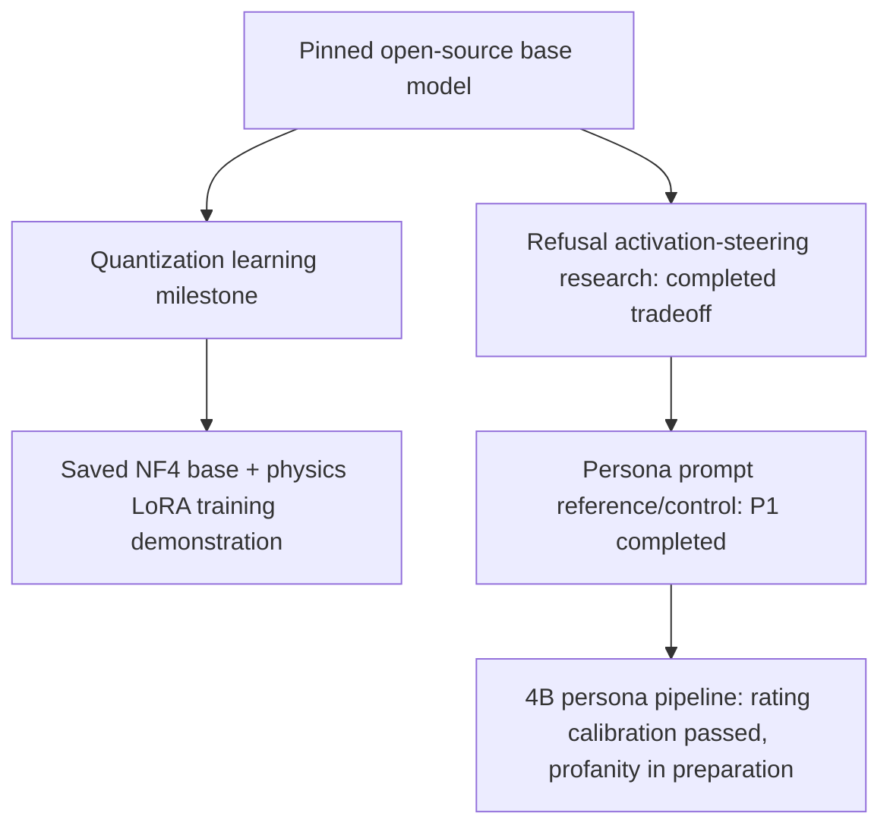

# Project tracks and future persona steering

Scope clarification from the user, 2026-11-14; discussed with Claude before
updating the roadmap. This is the current project map. Historical protocols
and results continue to describe the experiments as registered.

**Current priority:** the 4B refusal study is closed; the 4B persona pipeline is
open. The [three-trait rating calibration passed](persona_rating_calibration_completion_execution.md)
on clear authored cases; prepare the isolated profanity protocol next. Finish
isolated and bounded joint studies on 4B before further 14B work.
The completed 14B baseline remains a historical measurement. Older closeout or
transition language in frozen protocols is superseded by this current roadmap;
those records remain unchanged to preserve their experiment hashes.

## Separate learning objectives

| Track | Mechanism | Purpose and status |
| --- | --- | --- |
| Quantization | Change the numerical representation of a pinned model | Demonstrate compression, serialization, reload and evaluation; initial milestone complete. |
| Physics LoRA/QLoRA | Train adapter parameters on physics-paper text; keep the base frozen | Demonstrate fine-tuning on domain data; completed experimental adapter. Writing-quality improvement remains unestablished. |
| Refusal activation steering | Intervene on hidden activations during inference | Learn behavioral representation/control methods; completed experiments showed an effect with quality tradeoffs, without a validated usable setting. |
| Persona prompting | Change system instructions at inference | Define a desired tone and provide a reference/control for persona research. No adapter training. P1 completed without passing its acceptance rule. |
| Persona activation steering | Intervene on activations to influence written tone/style | Isolated 4B profanity design accepted; fixture/code preparation and run registration precede execution. Rudeness and sarcasm follow, then a separate joint stage. Finish the 4B pipeline before further 14B work. |

The physics adapter is a demonstration of the ability to fine-tune, not a
persona-steering task. Its physics-paper corpus, training loss, adapter rank
and learning rate belong to that training experiment. The practical learning
milestone is a working train/save/reload/evaluate/release workflow; it does not
require a better physics researcher or a proven PRL-quality writing assistant.

The behavioral program proceeds from refusal-steering research to persona/tone
research. A completed research stage can have a negative or tradeoff outcome.
Persona prompting is a preliminary reference experiment within the latter
program; it is neither fine-tuning nor an activation intervention. Both the
physics-training and behavioral tracks can start independently from the pinned
base model. Physics LoRA is not an input to the current persona experiments.

This diagram organizes the program; it does not claim that all historical runs
occurred in that order or that an accepted persona vector already exists.

## What the completed studies establish

- Earlier warm/neutral tone construction: three attempts stopped before judging
  or vector extraction, with mechanical upper bounds of 5, 31 and 46 eligible
  pairs against the registered 50-pair threshold. Length matching was a major
  constraint; the first warm prompt more than doubled typical response length.
  These attempts preceded the refusal studies. See the
  [tone execution record](tone_steering_execution.md).
- Physics adaptation: a saved/reloaded experimental adapter and documented
  evaluation. See the [physics execution record](physics_prl_execution.md).
- Refusal steering: single-block subtraction and all-block projection removal
  were tested. The selected intervention reduced refusal but failed final
  response-quality criteria. See the [methods guide](activation_steering_methods.md)
  and [execution record](refusal_reduction_execution.md).
- Persona P1: two system-prompt conditions on the unadapted BF16 base. The
  persona won 15/24 style comparisons but missed the registered style and gross
  quality-loss thresholds. No persona vector was extracted or applied. See the
  [P1 record](persona_prompt_execution.md).

The self-contained physics/math questions in P1 were content-retention probes.
They did not train a model, load the physics adapter, use the PRL training corpus
as persona data, or assess improvements in PRL writing. A task's subject matter
does not determine whether the method is fine-tuning, prompting or steering.

## User-selected persona targets and simultaneous control

The user's clarified goal is **profanity, rudeness and sarcasm**, with three
simultaneously adjustable activation controls. The previously suggested
conciseness/formality/warmth roadmap was a misunderstanding and is superseded.
It does not replace these targets.

| Direction | Intended written behavior | Distinction to preserve |
| --- | --- | --- |
| Profanity | Amount/intensity of swearing | Swearing can be friendly or emphatic without being rude. |
| Rudeness | Impolite, abrasive or dismissive delivery | Rudeness can occur without profanity or sarcasm. |
| Sarcasm | Context-dependent ironic or mocking delivery | Sarcasm need not contain profanity or be rude. |

The target intervention is:

\[
h_l' = h_l
+ \alpha_p v_{\text{profanity}}
+ \alpha_r v_{\text{rudeness}}
+ \alpha_s v_{\text{sarcasm}}.
\]

At an intervention site, add the weighted sum once to the same hidden state.
The model weights stay fixed; this is activation steering, not a new physics
adapter or prompt-only persona switch. The directions must share the same
activation space at the selected block. If multiple blocks are used, specify
block-specific directions and intervention sites in the protocol.

The immediate milestone is three isolated steering experiments on Qwen3-4B,
in the order profanity, rudeness, sarcasm. Each is a complete learning result,
including construction, extraction, bounded development, locked confirmation,
vector save/reload verification and reporting. Simultaneous control follows as
a separate stage; it is not assumed to work. Complete this pipeline on 4B before
further 14B experiments. The already completed unmodified 14B baseline is kept
as historical evidence, without implying that the 4B persona work is complete.

Independent, linear or monotonic effects on generated language are hypotheses,
not consequences of the additive formula: later nonlinear computation can
couple the traits. A coefficient of zero removes that direction's contribution,
not the trait from the baseline. Strength units depend on vector normalization;
negative coefficients require testing rather than assuming an opposite effect.

Physics-adapter/steering interaction remains a separate optional research
question, not part of the physics demonstration or this persona objective.

## Development path toward joint control

1. Define separate ratings for all three traits. Use content-matched contrasts
   that vary one trait while controlling the other two, answer length and task
   meaning as far as practical. Use fictional dialogue or impersonal examples
   to make style distinguishable from factual correctness. Declare construction
   yield and length-tolerance gates before extraction, and calibrate the ratings
   on a small fixed set, particularly for contextual sarcasm.
2. Use prompts to construct/reference these contrasts, then extract candidate
   activation directions under a reviewed protocol. Do not reuse the refusal
   vector as a persona vector. Existing warm-tone and P1 results remain
   historical evidence, not validation of these new directions.
3. Calibrate each direction alone with a small declared set of blocks/strengths.
   Record vector normalization, token scope and per-trait effects, together
   with correctness, coherence and degeneration checks. Score all three traits
   even when only one vector is active. Lock a block and strength for a compact
   held-out confirmation, verify vector serialization/reload, and report each
   trait independently. Fix target-effect, crosstalk and quality criteria before
   development; avoid adaptive searches.
4. After isolated results, separately register pairwise combinations and then
   all-three mixtures. Combine only directions supported by isolated tests:
   at least two for a pair, all three for the full mixture. If fewer than two
   qualify, close this bounded attempt with that result. Score every trait for
   every condition, including neutral and single-direction controls, with the
   coefficient settings hidden from evaluators. A lexical profanity count can
   complement contextual judgments of rudeness and sarcasm. Measure
   whether changing one coefficient changes the other trait ratings. Preserve
   original directions when comparing any orthogonalization or other correction.
   Start with zero versus locked single-trait strengths (four cells for a pair,
   eight for all three). Report deviations from additive trait effects and the
   combined vector norm. Do not retune strengths after observing joint results.
5. Lock the chosen joint configuration before a compact held-out evaluation.
   Report cross-trait interference, usable strength ranges and failures. Do not
   claim independent knobs unless the measurements support them. Poor joint
   behavior is a valid outcome. Close and document the 4B pipeline before
   considering transfer to 14B; larger size is not a presumed stability fix.

This is the selected research objective. Exact data, block choices, coefficient
settings and stopping rules still need a concrete protocol. This documentation
correction launches no model generation, extraction, training or grading run.

A future persona LoRA would be another training experiment and would need its
own dataset and protocol. It is not the current persona-steering method or a
reason to restart the completed physics adapter exercise.

**Protocol status:** the [isolated profanity design](profanity_steering_protocol.md)
is reviewed and accepted for implementation. Fixture/code review and an exact
run registration are pending. Other isolated traits and joint control require
separate protocols; this roadmap is not their execution registration.
