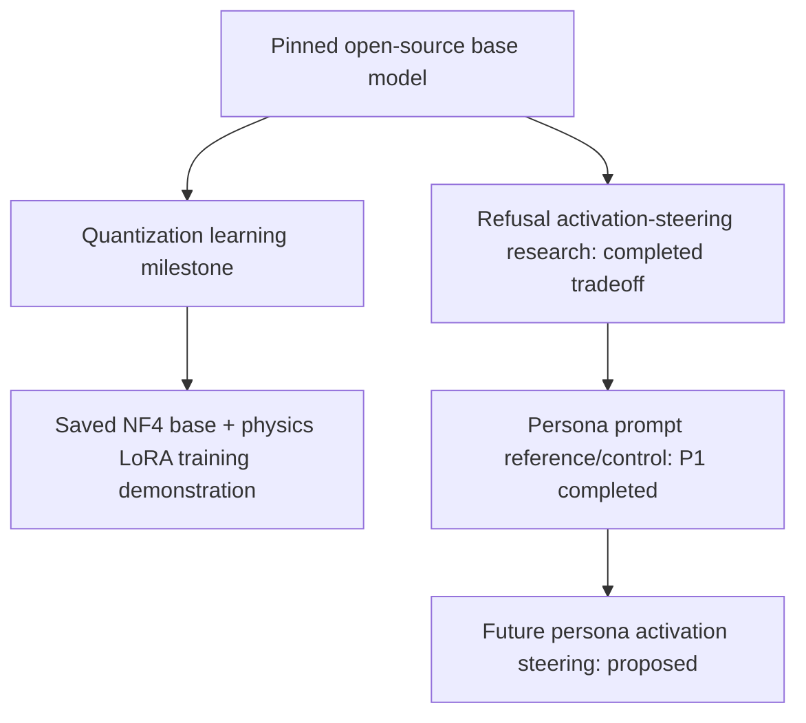

# Project tracks and future persona steering

Scope clarification from the user, 2026-11-14; discussed with Claude before
updating the roadmap. This is the current project map. Historical protocols
and results continue to describe the experiments as registered.

## Separate learning objectives

| Track | Mechanism | Purpose and status |
| --- | --- | --- |
| Quantization | Change the numerical representation of a pinned model | Demonstrate compression, serialization, reload and evaluation; initial milestone complete. |
| Physics LoRA/QLoRA | Train adapter parameters on physics-paper text; keep the base frozen | Demonstrate fine-tuning on domain data; completed experimental adapter. Writing-quality improvement remains unestablished. |
| Refusal activation steering | Intervene on hidden activations during inference | Learn behavioral representation/control methods; completed experiments showed an effect with quality tradeoffs, without a validated usable setting. |
| Persona prompting | Change system instructions at inference | Define a desired tone and provide a reference/control for persona research. No adapter training. P1 completed without passing its acceptance rule. |
| Future persona activation steering | Intervene on activations to influence written tone/style | The next behavioral research direction; proposed axes below are unregistered. |

The physics adapter is a demonstration of the ability to fine-tune, not a
persona-steering task. Its physics-paper corpus, training loss, adapter rank
and learning rate belong to that training experiment. The practical learning
milestone is a working train/save/reload/evaluate/release workflow; it does not
require a better physics researcher or a proven PRL-quality writing assistant.

The behavioral program proceeds from refusal-steering research to persona/tone
research. A completed research stage can have a negative or tradeoff outcome.
Persona prompting is a preliminary reference experiment within the latter
program; it is neither fine-tuning nor an activation intervention. Both the
physics-training and behavioral tracks can start independently from the pinned
base model. Physics LoRA is not an input to the current persona experiments.

This diagram organizes the program; it does not claim that all historical runs
occurred in that order or that an accepted persona vector already exists.

## What the completed studies establish

- Earlier warm/neutral tone construction: three attempts stopped before judging
  or vector extraction, with mechanical upper bounds of 5, 31 and 46 eligible
  pairs against the registered 50-pair threshold. Length matching was a major
  constraint; the first warm prompt more than doubled typical response length.
  These attempts preceded the refusal studies. See the
  [tone execution record](tone_steering_execution.md).
- Physics adaptation: a saved/reloaded experimental adapter and documented
  evaluation. See the [physics execution record](physics_prl_execution.md).
- Refusal steering: single-block subtraction and all-block projection removal
  were tested. The selected intervention reduced refusal but failed final
  response-quality criteria. See the [methods guide](activation_steering_methods.md)
  and [execution record](refusal_reduction_execution.md).
- Persona P1: two system-prompt conditions on the unadapted BF16 base. The
  persona won 15/24 style comparisons but missed the registered style and gross
  quality-loss thresholds. No persona vector was extracted or applied. See the
  [P1 record](persona_prompt_execution.md).

The self-contained physics/math questions in P1 were content-retention probes.
They did not train a model, load the physics adapter, use the PRL training corpus
as persona data, or assess improvements in PRL writing. A task's subject matter
does not determine whether the method is fine-tuning, prompting or steering.

## Proposed future persona targets

These are candidate learning axes, not a commitment to execute every study.
Start with one clearly measurable axis, then consider more contextual traits.
The order below is an advisory proposal, not a user-selected sequence. Claude
suggested placing formality before more context-dependent emotional expression.

| Proposed order | Written behavior | Main check beyond style preference |
| --- | --- | --- |
| 1 | Concise versus detailed delivery | Preserve required facts, quantities and constraints; brevity cannot win by dropping content. |
| 2 | Formal/professional versus conversational | Hold facts, audience and task constant. |
| 3 | Warm/supportive versus neutral | Preserve honest disagreement and correction of false premises; control length, which confounded earlier warmth contrasts. |
| 4 | Calm/composed versus energetic/enthusiastic | Separate energy from warmth, formality and answer length. |
| 5 | Calibrated assertiveness and constructive pushback | State warranted conclusions clearly, preserve uncertainty and correct flawed premises. P1 gives limited support on these tasks. |
| Later, optional | Playful or sarcastic versus literal presentation | Preserve meaning and audience fit; context makes this harder to define cleanly. |

Answer-first directness is another possible narrow delivery axis. It should be
separated from brevity when designing a contrast: putting the conclusion first
and using fewer words are different changes. The proposed first study should
choose one, rather than repeat P1's broad composite target.

A longer-term **steady/resolute or heroic-style persona** could combine direct
delivery, composure, warmth and evidence-calibrated assertiveness after its
components have been evaluated. This refers to expressed language and helpful
behavior, not an internal emotional state or invented personal experience.
Factual accuracy and appropriate uncertainty remain quality requirements across
all axes; unsupported certainty is not a desired control setting.

The early roadmap's profanity/rudeness/sarcasm progression is superseded as the
default priority by the axes above. Those older examples are not required
milestones or active experiments. Similarly, physics-adapter/steering
interaction is a separate optional research question, not part of the completed
physics demonstration or the current persona program.

## Method for a future axis

1. Define one observable target and content/calibration requirements. Use the
   existing P1 outputs for a small diagnosis where helpful; retain its original
   grades and stopping decision.
2. Establish a matched neutral/styled prompt reference on benign tasks. This
   characterizes the desired output; prompting alone establishes no activation
   control. Keep answer content and confounding style dimensions comparable.
3. Under a separate protocol, extract a candidate direction from appropriate
   contrastive activations and test a bounded inference-time intervention.
   Register block, token scope and actual strength; no automatic layer/strength
   grid is required. Do not substitute the refusal vector for a persona vector.
4. Compare neutral, prompted-reference and activation-steered responses with
   separate style, correctness, calibration and invalid-output measurements.
   Use development criteria and an unseen final set, with stopping rules fixed
   before outputs. Preserve failures and uncertainty.

A future persona LoRA would be another training experiment and would need its
own dataset and protocol. It is not the current persona-steering method or a
reason to restart the completed physics adapter exercise.

**Unregistered roadmap: this document authorizes no new model generation,
training, vector extraction or grading run.** The immediate documentation task
clarifies the program; any next experiment needs a concrete reviewed protocol.
