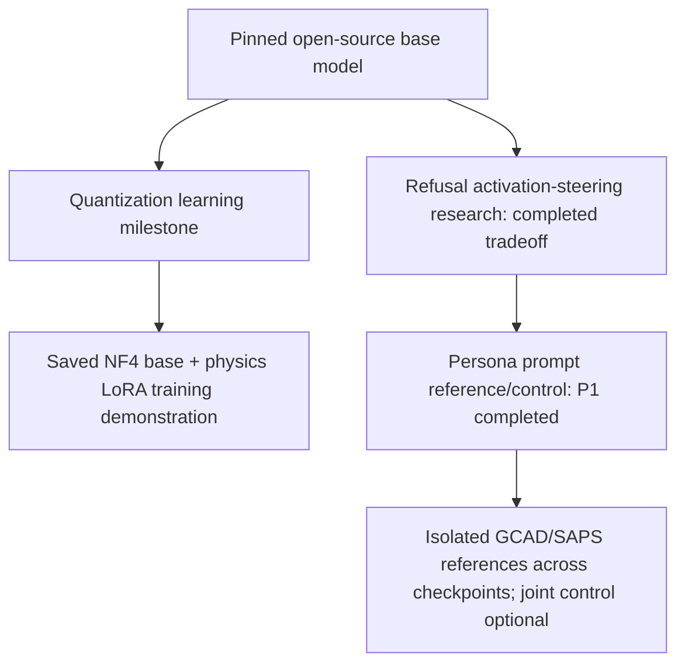

# Project tracks and future persona steering

Scope clarification from the user, 2026-11-14; discussed with Claude before
updating the roadmap. This is the current project map. Historical protocols
and results continue to describe the experiments as registered.

**Latest references:** see the [consolidated four-behavior record](steering_reference.md).
GCAD profanity and the separate lower-strength GCAD sarcasm study on
Qwen2.5-7B passed held-out confirmation and are retained. Sarcasm has a narrow
coherence margin and measurable impoliteness coupling. Author-model GCAD
impoliteness and Mistral fixed/adaptive sarcasm also have positive references
with quality limits. Refusal reduction remains a partial effect that
failed final quality. The record spans three checkpoints; cross-model vectors
cannot be combined. The three Qwen7 GCAD style banks share coordinates, but
their joint use is untested. The [GCAD mathematics and joint-control discussion](gcad_and_combined_control.md)
records the completed common-model follow-up and evidence boundaries.
The Qwen7 benign refusal screen closed at3/100 semantic refusals versus five
prefix flags; no GCAD refusal controller was tested. No joint grid is released.

**4B track status:** the 4B refusal study is closed; the 4B persona pipeline is
open. The [three-trait rating calibration passed](persona_rating_calibration_completion_execution.md)
on clear authored cases. The [profanity pilot closed with a development null](profanity_steering_execution.md);
[rudeness and sarcasm also closed with development nulls](isolated_persona_traits_execution.md).
No isolated setting qualified in the tested range. The user selected the
[literature-first isolated workflow](persona_literature_workflow.md), with author
data/code before custom extensions. Source-tested implementations are complete;
full rudeness/profanity PV grids closed with development nulls. SAPS sarcasm
completed a held-out paraphrase reference pass, with a meaning-preservation cost
and small capability checks passing. See the [reference execution record](persona_reference_execution.md). Joint control is a separate experimental topic deferred
for later discussion, even after isolated success. The isolated 4B control
work remains unvalidated; further 14B experiments remain deferred.
The completed 14B baseline remains a historical measurement. Older closeout or
transition language in frozen protocols is superseded by this current roadmap;
those records remain unchanged to preserve their experiment hashes.

## Separate learning objectives

| Track | Mechanism | Purpose and status |
| --- | --- | --- |
| Quantization | Change the numerical representation of a pinned model | Demonstrate compression, serialization, reload and evaluation; initial milestone complete. |
| Physics LoRA/QLoRA | Train adapter parameters on physics-paper text; keep the base frozen | Demonstrate fine-tuning on domain data; completed experimental adapter. Writing-quality improvement remains unestablished. |
| Refusal activation steering | Intervene on hidden activations during inference | Learn behavioral representation/control methods; completed experiments showed an effect with quality tradeoffs, without a validated usable setting. |
| Persona prompting | Change system instructions at inference | Define a desired tone and provide a reference/control for persona research. No adapter training. P1 completed without passing its acceptance rule. |
| Persona activation steering | Intervene on activations to influence written tone/style | Custom 4B pilots closed with nulls; Qwen7 GCAD profanity/impoliteness/sarcasm and Mistral sarcasm references are established with their quality limits. Cross-effects are descriptive; joint control is optional and 14B work stays deferred. |

The physics adapter is a demonstration of the ability to fine-tune, not a
persona-steering task. Its physics-paper corpus, training loss, adapter rank
and learning rate belong to that training experiment. The practical learning
milestone is a working train/save/reload/evaluate/release workflow; it does not
require a better physics researcher or a proven PRL-quality writing assistant.

The behavioral program proceeds from refusal-steering research to persona/tone
research. A completed research stage can have a negative or tradeoff outcome.
Persona prompting is a preliminary reference experiment within the latter
program; it is neither fine-tuning nor an activation intervention. Both the
physics-training and behavioral tracks can start independently from the pinned
base model. Physics LoRA is not an input to the current persona experiments.

This diagram organizes the program rather than the exact chronology. The
consolidated references identify the accepted model-specific artifacts and
their limits.

## What the completed studies establish

- Earlier warm/neutral tone construction: three attempts stopped before judging
  or vector extraction, with mechanical upper bounds of 5, 31 and 46 eligible
  pairs against the registered 50-pair threshold. Length matching was a major
  constraint; the first warm prompt more than doubled typical response length.
  These attempts preceded the refusal studies. See the
  [tone execution record](tone_steering_execution.md).
- Physics adaptation: a saved/reloaded experimental adapter and documented
  evaluation. See the [physics execution record](physics_prl_execution.md).
- Refusal steering: single-block subtraction and all-block projection removal
  were tested. The selected intervention reduced refusal but failed final
  response-quality criteria. See the [methods guide](activation_steering_methods.md)
  and [execution record](refusal_reduction_execution.md).
- Persona P1: two system-prompt conditions on the unadapted BF16 base. The
  persona won 15/24 style comparisons but missed the registered style and gross
  quality-loss thresholds. No persona vector was extracted or applied. See the
  [P1 record](persona_prompt_execution.md).

The self-contained physics/math questions in P1 were content-retention probes.
They did not train a model, load the physics adapter, use the PRL training corpus
as persona data, or assess improvements in PRL writing. A task's subject matter
does not determine whether the method is fine-tuning, prompting or steering.

## Current user-selected goal: individual controls

The user clarified the objective after the GCAD discussion: establish reliable
individual controls for refusal reduction, profanity, rudeness and sarcasm.
Prefer GCAD if it works well across traits. Otherwise retain and tune the
best supported intervention for each trait. Different methods are an acceptable
final outcome. Simultaneous control is not the ultimate goal or a condition
for completing the individual-control learning pipeline.

| Behavior | Intended effect | Interpretation |
| --- | --- | --- |
| Refusal reduction | Fewer refusals under the registered task, with answer-quality and boundary measurements | Current reference showed a partial effect with failed quality. |
| Profanity | Amount/intensity of swearing | It can co-occur with rudeness; the retained study's original friendly-swearing rubric remains unchanged. |
| Rudeness/impoliteness | Abrasive, dismissive or impolite delivery | The author reference measures a broad construct; task/rubric differences stay explicit. |
| Sarcasm | Context-recognizable verbal irony | It may correlate with rudeness or profanity; those correlations do not invalidate a sarcasm effect. |

The previously substituted mild-tone roadmap remains superseded. Physics LoRA
remains a separate demonstration; a future persona LoRA would be a separate
training study.

## Per-trait workflow

1. Follow an established method/source first. Specify the target construct,
   checkpoint, extraction data, intervention sites and bounded tuning budget.
2. Extract and verify that trait's model-specific representation. Prompted
   references establish what behavior the model can express under instruction.
3. Tune the individual intervention against its own target and quality rules.
   Freeze a selected setting before held-out confirmation. Cross-trait effects
   are descriptive, not an off-axis rejection gate.
4. Retain a confirmed method/settings profile. If GCAD fails, preserve an
   established alternative method or document the bounded null. Do not force
   every trait to use the same mechanism or coefficient.
5. Save/reload/check and report both effects and limitations. The immediate
   next studies are isolated GCAD sarcasm, then isolated GCAD refusal reduction
   on the common Qwen2.5 checkpoint. The existing model-specific references
   remain valid evidence while these transfers are tested.

The isolated 4B pipeline still precedes further 14B work; an optional joint
study is not a prerequisite for that milestone. Frozen historical protocols
and results remain unchanged.

## Descriptive cross-effects and optional joint work

Score relevant traits on individual-intervention outputs to describe coupling
or correlations. Use comparable questions/decoding where feasible, and label
model/task differences. A cross-effect matrix records how one active control
changes the other trait ratings; score correlations are a separate descriptive
summary. Neither is evidence of independent causal dimensions by itself.

If correlations are strong, report them. Do not automatically orthogonalize,
search for cancellation, or reject an otherwise qualifying individual control
because it also changes another trait. Existing study-specific constructs and
quality gates remain as registered; the clarification does not revise old scores.

Pairwise or multi-trait mixtures are optional later research, requiring their
own protocol if chosen. Their failure would not erase successful individual
controls or make the primary project incomplete. Vectors from different model
coordinate systems cannot be added directly even if individual methods work.

A future persona LoRA would be another training experiment and would need its
own dataset and protocol. It is not the current persona-steering method or a
reason to restart the completed physics adapter exercise.

**Historical 4B pilot status:** profanity, rudeness and sarcasm closed with development nulls.
The [rudeness/sarcasm design](isolated_persona_traits_protocol.md), fixtures and
code are accepted; 16 focused CPU checks passed. Both studies had separate
pre-call registrations and preserved their stopping rules. See the
[execution record](isolated_persona_traits_execution.md). Confirmation, selected
vector generation replay and retention were skipped under the nulls. Joint
control is unexecuted and needs its own protocol after supported isolated
settings exist; this roadmap is not an execution registration.
