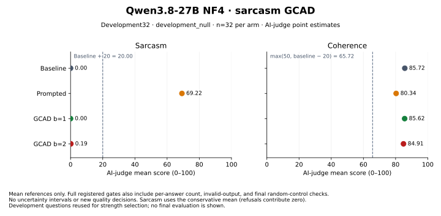

# Qwen3.8-27B sarcasm GCAD: execution

Status: **closed as a development null, 2026-11-19**. Neither registered
GCAD strength qualified. No final evaluation ran and no controller is retained.
The owner resumed this separate study with GPUs available. The
[prospective design](qwen38_sarcasm_plan.md) is frozen;
its original proposal status is historical. The
[R0 registration](../results/protocols/qwen38-sarcasm-gcad-01.json) records
the accepted source, plan, review and input hashes. Completed quantization
and QLoRA outcomes are unchanged.

## Scope and fixed decisions

Use the saved text-only Qwen3.8-27B NF4 base at the pinned upstream revision.
Extract a fresh sarcasm bank from 100 matched instruction/question pairs.
Apply GCAD at full-attention blocks 23, 27, 31, 35, 39 and 43; the linear
attention blocks receive no direct intervention. Cropped contributions include
the native sigmoid output gate; raw deltas are added after the output
projection. Response, pair, key and query means accumulate in FP32.

Development compares coefficients 1 and 2 with baseline and prompted arms.
Select the lowest qualifying coefficient by the fixed sarcasm, coherence and
invalid-output gates. Only then run the final 32 questions with baseline,
prompted, selected and random arms. These questions were used on 4B/7B:
this is a reused cross-model evaluation, not a fresh project-held-out test.
No final 27B generation occurred.

## Result

The [authoritative closeout](../results/qwen38_sarcasm_01.json) agrees with
the frozen runner's decision. The [independent scientific review](../results/reviews/qwen38_sarcasm_implementation_review_10.md)
recomputed the metrics and gates directly from the saved predictions and scores.

| Development arm, n=32 | Sarcasm /100 | Answers scoring at least 50 | Coherence /100 | Invalid |
| --- | ---: | ---: | ---: | ---: |
| Baseline | 0.000 | 0/32 | 85.719 | 0 |
| Prompted reference | 69.219 | 29/32 | 80.344 | 0 |
| GCAD coefficient 1 | 0.000 | 0/32 | 85.625 | 0 |
| GCAD coefficient 2 | 0.188 | 0/32 | 84.906 | 0 |

Both GCAD settings fail the required sarcasm gain of 20 points and the
minimum of eight answers scoring at least 50. Both pass the coherence and
invalid-output gates. All 32 answers at each strength differ from baseline:
the intervention changed text but did not induce the registered sarcasm effect.
The prompted reference shows that the model can express sarcasm on these
questions under the same scoring setup. This does not establish a general
prompting recommendation or identify whether the GCAD direction or dose caused
the null. No higher strength was tested in that study. The separately registered
[instruction-activation and stronger-GCAD follow-up](qwen38_sarcasm_followup_execution.md)
is reported independently.

The [figure receipt](assets/qwen38_sarcasm.json) identifies the data and plot
source. Means are AI-judge point estimates; the development set is used for
selection, and no final or random-control evaluation is shown.

## Completed mechanics

The [R1 record](../results/protocols/qwen38-sarcasm-gcad-mechanics-01.json)
binds the successful real-model synthetic-bank smoke and judge audit.

| Check | Observed |
| --- | --- |
| Synthetic phase | 6 generations, 2 teacher-forced forwards, 4 logit forwards; 65.67 seconds including the model load within the phase |
| Zero and cleanup parity | Exact generated-token and logit equality; original hook counts restored |
| Nonzero intervention | Maximum logit change 2.21875; final hidden state changes |
| Hook coverage | Each of the six sites: one prefill, 31 decode calls, zero errors per steered generation |
| Gated reconstruction relative error | 0.0066–0.0095, below the registered 0.02 limit |
| Gate omitted | Relative error 5.00–8.70; the native gate is necessary |
| Crop-plus-complement relative error | 0.0024–0.0032, below the registered 0.01 limit |
| Peak PyTorch allocated memory | 18.006 GB; this is not total device memory or a long-context budget |
| Judge isolation audit | Frozen Claude CLI 2.1.327, requested model only, tools disabled, fresh context returned `UNKNOWN` |

The synthetic bank checks implementation mechanics. It is not the fitted
sarcasm bank or evidence of sarcasm quality. The earlier strict cached/full-prefix
logit-equivalence failure remains unresolved; every compared arm keeps the
same cached generation path and batch size one.

The [pre-development recording-scope addendum](../results/protocols/qwen38-sarcasm-diagnostics-addendum-01.json)
corrects two descriptive items in the frozen plan: realized shift magnitude
and a new steered NF4 cached-versus-recomputed comparison are **unmeasured**.
The code records hook coverage and raw delta norms; it does not retain
per-token coefficients. Raw random-control norm matching cannot establish
realized energy matching. The 0.125 cache discrepancy is historical and
unsteered. No primary gate or study setting changes.

The new research CPU tests pass 15/15; the unchanged Qwen2/Qwen3 regressions
pass 15/15. The independent closeout analyzer passes 16/16, including a
second run by the scientific advisor. These are mechanics and reporting
checks, not quality results.

## Execution and resource accounting

The retained run is `outputs/qwen38-sarcasm-gcad-01/`. All 200 elicitation
replies were graded in 50 first-valid batches; 90 matched pairs passed the
fixed eligibility rule, covering all 20 extraction questions. The bank was
extracted from 180 exact raw trajectories. An independent float64 recomputation
verified its FP32 deltas, keys and demands, followed by successful real-bank
mechanics. The 128 development replies were graded in 32 first-valid batches.
All 82 study batches succeeded on their first attempt; no failed or uncertain
calls remain.

| Work | GPU process wall time, including load |
| --- | ---: |
| Synthetic mechanics | 71 seconds |
| Elicitation | 9,186 seconds |
| Bank extraction | 110 seconds |
| Real-bank mechanics | 51 seconds |
| Development | 2,953 seconds |
| **Total** | **3.436 GPU-hours (3h 26m)** |

Counts: **340 generations, 71,908 generated tokens, 182 teacher-forced
forwards, eight logit forwards, 82 study judge calls and one isolation audit**.
Every count and resource limit passed. Elicitation generation rows measured
5.58 tokens/second; development rows measured 6.99. These are this workflow's
timings, not an optimized inference benchmark or total project calendar time.
The [earlier 27B timing summary](../results/qwen38_timing_summary_01.json)
separates quantization builds, comparisons and QLoRA training/evaluation.

The [independent analyzer registration](../results/protocols/qwen38-sarcasm-analysis-01.json)
predates development selection. The null branch closes before final generation:
final questions, random-control generation, final impoliteness scoring and
H14-excluded final figures were not evaluated. Saved random tensors are unused
controls, not random-control results.

## Interpretation limits

- This tests the native NF4 model at six full-attention sites. The historical
  unsteered cache discrepancy reached 0.125; compared arms used cached batch-one
  generation. No new steered cache-equivalence test was made.
- Realized shift norms and energy are unmeasured. Raw delta norms of
  0.85–1.36 do not separate an unsuitable direction from an insufficient dose.
  A [later normalization correction](../results/reviews/qwen38_sarcasm_norm_interpretation_correction_01.md)
  clarifies that the saved reconstruction denominator is a whole-sequence
  norm; it cannot establish a per-token relative dose. The decision is unchanged.
- Elicitation reached the 256-token cap on 197/200 replies; development reached
  the 160-token cap on 127/128. Scores and bank fitting use those capped texts.
- Historical rubric bytes are preserved, while the judge payload envelope and
  rating schema differ from the 7B/4B studies. AI judgments are not human
  validation, factual correctness, or broad capability retention evidence.
- Judge isolation was checked with one negative probe; it is a mechanical
  check, not proof of model independence.
- FP32 accumulation and exact raw-trajectory teacher forcing are declared
  port differences from earlier pipelines.
- Extraction/development fixtures are reused project material. The known
  x18/H14 topical overlap concerns a final question that was never evaluated.
  Outcomes are model-specific and do not establish a model-size effect.

Raw outputs, judge journals, model assets and the superseded CPU preparation stay local.
Compact protocols and reviews are retained in `results/`. The bounded study
is complete. Any follow-up requires a separate design and fresh development
data; this registration does not authorize another strength or layer search.
