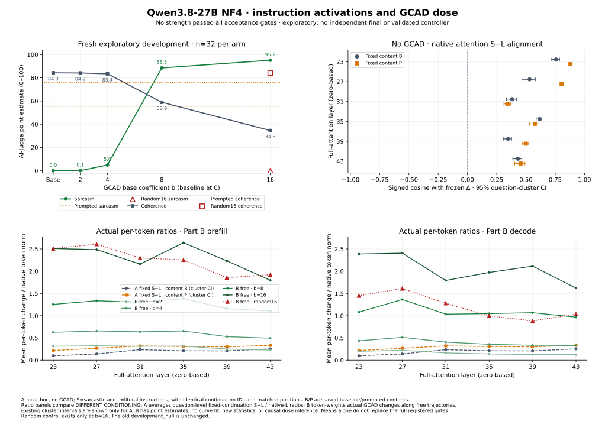

# Qwen3.8-27B sarcasm: instruction activations and stronger GCAD

Status: **complete, 2026-11-19**. Stronger GCAD induced strong judged sarcasm at strengths 8 and 16, with a coherence cost that failed the registered acceptance gates. No exploratory candidate qualifies: `exploratory_null_through_b16`. This is a quality-gate null, not an absence of sarcasm. The original [strength-1/2 study](qwen38_sarcasm_execution.md) remains closed as its own development null.

The [authoritative analysis](../results/qwen38_sarcasm_followup_01.json), [independent closeout review](../results/reviews/qwen38_sarcasm_followup_review_06.md) and [prospective registration](../results/protocols/qwen38-sarcasm-followup-01.json) agree. The [design](qwen38_sarcasm_followup_plan.md) and [reviewed source](../results/reviews/qwen38_sarcasm_followup_review_03.md) were frozen before any new calls. All model weights remained frozen.

For practical strength controls and the model-specific equations, see the
[theory and tuning guide](qwen38_sarcasm_gcad_guide.md) and the
[HF card draft](qwen38_sarcasm_hf_card_draft.md).

## Stronger GCAD: behaviour and quality

Fresh exploratory development used 32 new project questions, seven fixed arms, greedy cached batch-one generation and a 160-token limit. Sarcasm, coherence and impoliteness are blinded AI-judge scores out of 100. “Coherent and sarcastic” means both scores are at least 50; this is descriptive, not a replacement acceptance rule.

| Arm, n=32 | Sarcasm | Sarcasm ≥50 | Coherence | Coherent and sarcastic | Impoliteness |
| --- | ---: | ---: | ---: | ---: | ---: |
| Baseline | 0.00 | 0/32 | 84.28 | 0/32 | 1.91 |
| Explicit sarcasm instruction | 55.56 | 25/32 | 76.00 | 25/32 | 52.09 |
| GCAD 2 | 0.09 | 0/32 | 84.16 | 0/32 | 2.22 |
| GCAD 4 | 4.97 | 0/32 | 83.44 | 0/32 | 6.75 |
| GCAD 8 | 88.50 | 32/32 | 58.94 | 26/32 | 70.72 |
| GCAD 16 | 95.16 | 32/32 | 34.59 | 2/32 | 81.53 |
| Random direction 16 | 0.00 | 0/32 | 84.28 | 0/32 | 2.09 |

At strength 8, all answers score at least 50 for sarcasm, and 26 also reach coherence 50. However, mean coherence falls **25.34 points** from baseline: 58.94 versus the registered minimum of **64.28** (baseline minus 20). This is its only failed gate. Strength 16 also fails the absolute coherence minimum of 50; 30 of its 32 answers score below 50 for coherence. Strengths 2 and 4 preserve coherence but fail the sarcasm gates. Invalid-output counts are zero in every arm.

No strength between 4 and 8 was registered or tested. The exploratory null is retained without changing a gate or selecting a new dose. No independent final set ran, and no validated controller is retained.

The [figure receipt](assets/qwen38_sarcasm_followup.json) binds the source analysis and rendered values. Lines connect tested point estimates; they do not estimate untested strengths. Part B has no registered confidence intervals in this figure.

## What explicit instructions change without GCAD

Part A replays both saved 160-token continuations for each of the old 32 questions under sarcastic (S), literal (L) and absent (N) system instructions. The primary S−L contrast holds continuation IDs and positions fixed: both systems add exactly 45 tokens. It captures all 64 residual block means, six attention-output means and cropped system contributions, gate values and continuation NLL. The 10,000 bootstrap resamples use 32 question clusters, carrying both continuations and all three contexts together.

The [independent activation review](../results/reviews/qwen38_sarcasm_followup_review_05.md) verifies all 192 saved cells and cross-checks signed cosines independently.

- Full attention-output S−L changes align positively with the bank at all six sites for both saved contents: signed cosines **0.34–0.88**, with every question-cluster interval above zero. The three random geometric references lie within ±0.03; these are descriptive references, not a null interval.
- Mean paired per-token S−L changes are **10–34%** of native literal-context norms. The pooled-mean component is smaller, **3.5–14%**, reflecting variation and cancellation. These are distinct measures.
- The sarcastic system lowers the measured GCAD gate relative to the literal system at every site, by **0.015–0.075**. It makes the saved sarcastic continuation more likely: mean NLL(S)−NLL(L) is **−0.37** for that continuation, versus **+0.15** for the saved baseline continuation.
- The norm of the mean instruction contrast in the residual stream grows with depth, from roughly **0.3–0.4%** of native norm at block 3 to **9–11%** at block 63. The saved-content contrast is larger at sampled depths. The canonical analysis retains the complete 64-block profile.

This supports alignment with the whole instruction contrast. It does not isolate a pure sarcasm feature: S/L use one instruction pair already represented in the five-pair bank. The absent-system comparison also changes token positions and remains secondary.

## Measured intervention size and random reference

The observer preserves the frozen GCAD outputs exactly and records three different quantities: the algebraic coefficient-times-delta norm, the requested model-dtype addition operand, and the actual FP32 difference between rounded steered and original outputs. Prefill and decode are separate, with token-weighted summaries.

| Arm | Actual/native ratio, prefill range over six sites | Decode range over six sites |
| --- | ---: | ---: |
| GCAD 2 | 0.23–0.33 | 0.13–0.22 |
| GCAD 4 | 0.50–0.66 | 0.33–0.51 |
| GCAD 8 | 1.11–1.38 | 0.97–1.37 |
| GCAD 16 | 1.79–2.64 | 1.62–2.41 |
| Random 16 | 1.86–2.61 | 0.88–1.61 |

The random control exists only at strength 16. It matches the nominal strength, coefficient rule, key/demand bank and raw delta norms; **it does not match realised shifts** along diverging trajectories. Its decode gates are lower than the bank direction's. The registered b16-minus-random sarcasm contrast is **+95.16 points**, exceeding the descriptive +20 reference. This concerns one seed and one strength; it does not establish general specificity or rescue b16's coherence failure. Strength 8 has no random control.

The old extraction norm was a whole-sequence Frobenius norm and did not support the earlier per-token dose ratios. The [normalization correction](../results/reviews/qwen38_sarcasm_norm_interpretation_correction_01.md) withdraws that interpretation, including reviews 04, 09 and 10. This follow-up measures per-token quantities directly. Fixed-continuation instruction effects and free-generation shifts condition on different sequences and cannot identify dose as the cause of the earlier null.

## Verification, time and retained evidence

All **24 research CPU tests pass**, including recorder parity at strengths 0/2/16, exact raw-ID replay, capture neutrality, manual norm recomputation, failure guards, question bootstrap arithmetic and complete/interrupted closeout schemas. Real-model mechanics pass exact zero/cleanup and frozen-recorder parity, nonzero b2, per-site coverage and gated attention reconstruction. The [mechanics review](../results/reviews/qwen38_sarcasm_followup_review_04.md) also verifies the isolated judge audit.

The independent advisor verified every generation receipt and input, then parsed all 84 raw judge replies independently. Scores, all gates and the outcome match the canonical analysis. Every batch succeeded on its first attempt; all used only `claude-opus-5-5`, with zero refusals. The judge snapshot was checked before and after each fresh, tools-off isolated call.

| Work or counter | Used |
| --- | ---: |
| GPU process, including load, mechanics, replay and generation | **6,347.74 seconds; 1.763 GPU-hours** |
| Judge process | 491.38 seconds |
| End-to-end launcher | **6,842.68 seconds; 1h 54m** |
| Generations | 232: eight mechanics and 224 study answers |
| Generated/reserved tokens | 36,096 including mechanics |
| Teacher-forced passes | 194: two mechanics and 192 replay cells |
| Logit forwards | Five |
| Judge starts | 84 study calls plus one audit |
| Activation tensor storage | 1,550,390,272 bytes; below 2 GiB |

All registered counts and the four-GPU-hour/twelve-wall-hour ceilings passed. Stage timings are workflow observations, not an optimized inference benchmark. The conservative pre-run estimate was 1.7–2.3 GPU-hours and 3.5–6 hours end to end; judging was substantially faster than estimated.

The retained run is `outputs/qwen38-sarcasm-followup-01/`. It contains frozen prompts, raw IDs, model/source bindings, tensors, per-token telemetry, receipts and judge journals. The compact canonical result is tracked separately; raw artifacts remain local and ignored. The [earlier timing summary](../results/qwen38_timing_summary_01.json) records quantization and QASPER/PRL training/evaluation.

## Limits and interpretation

All 224 fresh answers reached the 160-token cap, including baseline. The fitted bank also uses the earlier capped elicitation replies. Results concern this NF4 model, six directly steered full-attention sites, one fixed bank, 32 convenience questions and one random-control seed. The known strict cache/recompute discrepancy remains; compared generation arms share the same cached path. AI-judged coherence does not establish factual correctness or general capability retention.

Impoliteness rises alongside sarcasm: 70.72 at strength 8 and 81.53 at strength 16. This experiment does not show sarcasm separable from rudeness. Pooled sarcasm/impoliteness correlation is confounded by arm; within-arm values are descriptive. The no-GCAD instruction analysis is post-hoc and concerns whole wording, while the behavioural experiment is exploratory without independent final validation.

The observations show that the bank can induce sarcasm at stronger settings, accompanied by quality loss. They do not diagnose the original null's cause or establish that a single larger coefficient reproduces the full instruction-conditioned computation.
