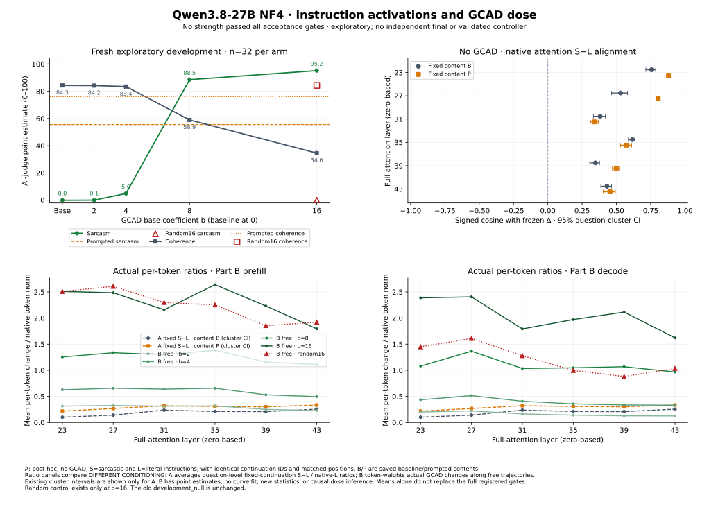

# 27B sarcasm: results and interpretation

GCAD induced strong judged sarcasm on Qwen3.8-27B at strengths 8 and 16,
with coherence losses that failed the registered acceptance rules. **No tested
strength passed all gates.** The original study closed as `development_null`;
the separate stronger-setting follow-up closed as `exploratory_null_through_b16`.
The [published tunable controls](qwen38_sarcasm_release.md) are an experimental
demonstration, with strength 8 as the owner-selected default.

For the method shared with the 4B/7B studies, see the
[trait-steering theoretical background](trait_foundations.md#gcad-starts-from-the-attention-writer).
The model weights remain frozen: GCAD edits attention-output activations during inference.

## Behaviour and quality

The original development study compared strengths 1 and 2 on 32 questions.
Sarcasm was 0.00 and 0.19, versus 0.00 for baseline and 69.22 for an explicit
sarcasm instruction. Neither strength qualified, so its conditional final
evaluation never ran. Both settings passed coherence and invalid-output rules;
both failed the sarcasm gain and count requirements. Every steered answer
differed from baseline. Those development questions were reused from the 4B/7B
studies, so this is not a controlled model-size comparison.

The separately registered follow-up used **32 fresh project questions**, seven
fixed arms and a 160-token cap. These are exploratory development results,
without an independent final evaluation. Scores below are blinded AI judgments
out of 100; “coherence <50” counts individual answers, not a new acceptance rule.

| Arm | Sarcasm | Sarcasm ≥50 | Coherence | Coherence <50 | Both scores ≥50 | Impoliteness | Gate result |
| --- | ---: | ---: | ---: | ---: | ---: | ---: | --- |
| Baseline | 0.00 | 0/32 | 84.28 | 0/32 | 0/32 | 1.91 | Reference |
| Explicit sarcasm instruction | 55.56 | 25/32 | 76.00 | 0/32 | 25/32 | 52.09 | Reference |
| GCAD 2 | 0.09 | 0/32 | 84.16 | 0/32 | 0/32 | 2.22 | Fails sarcasm |
| GCAD 4 | 4.97 | 0/32 | 83.44 | 0/32 | 0/32 | 6.75 | Fails sarcasm |
| GCAD 8 | 88.50 | 32/32 | 58.94 | 6/32 | 26/32 | 70.72 | Fails relative coherence |
| GCAD 16 | 95.16 | 32/32 | 34.59 | 30/32 | 2/32 | 81.53 | Fails both coherence rules |
| Random direction 16 | 0.00 | 0/32 | 84.28 | 0/32 | 0/32 | 2.09 | Descriptive reference |

At strength 8, coherence **58.94 <64.28**, the required baseline-minus-20 floor;
this is its only failed gate. Strength 16 also fails the absolute floor of 50.
Invalid-output counts are zero in every arm. All 224 answers reached the cap.
Untested intermediate strengths are configurable in the runtime, but no
balanced setting has been established.

The [canonical analysis](../results/qwen38_sarcasm_followup_01.json) and
[independent closeout review](../results/reviews/qwen38_sarcasm_followup_review_06.md)
retain exact values, all gate booleans and the figure's interpretation limits.
Connecting lines do not estimate behaviour at untested strengths.

## What explicit instructions change

A post-hoc analysis replayed two saved continuations per old question under
sarcastic, literal and absent system instructions: 192 teacher-forced cells.
The primary sarcastic-minus-literal contrast held continuation tokens and their
positions fixed, with both system prompts adding exactly 45 tokens.

The attention-output changes aligned positively with the bank at all six
intervention sites: signed cosines **0.34–0.88**, with all question-bootstrap
intervals above zero. Paired per-token changes were **10–34%** of native
literal-context norms; the pooled-mean component was smaller, **3.5–14%**.
The sarcastic instruction nevertheless lowered the separate GCAD gate at every
site, by **0.015–0.075**; the gate is a compatibility proxy, not a detector of
sarcastic intent. It made the saved sarcastic continuation more likely:
mean NLL(S)−NLL(L) was **−0.37**, versus **+0.15** for the saved baseline continuation.

This compares the whole instruction wording, using one pair represented in the
bank. It does not isolate a pure sarcasm feature or diagnose the earlier null.
Fixed-continuation instruction effects and free-generation steering condition
on different sequences. The [detailed activation record](qwen38_sarcasm_followup_execution.md#what-explicit-instructions-change-without-gcad)
retains residual profiles, bootstrap details and full shift telemetry.

## Measured steering shifts

The follow-up separately recorded the algebraic coefficient-times-delta norm,
the rounded requested operand and the actual FP32 output difference. The
[shared theory](trait_foundations.md#nominal-strength-versus-realised-shift)
defines these quantities. The table gives token-weighted decode actual/native
ratios, ranging over the six sites; it describes these trajectories only.

| Arm | Decode actual/native ratio |
| --- | ---: |
| GCAD 2 | 0.13–0.22 |
| GCAD 4 | 0.33–0.51 |
| GCAD 8 | 0.97–1.36 |
| GCAD 16 | 1.62–2.41 |
| Random direction 16 | 0.88–1.61 |

## Scope and limits

The profile uses the pinned NF4 base, a bank fitted from 90 eligible matched
pairs across five instruction pairs, and six full-attention sites. Generation
is single-turn English, without a system prompt, greedy with repetition penalty
1.05, cached batch one and capped at 160 output tokens. Other contexts and
backends are untested.

Sarcasm and impoliteness rose together; the study does not establish their
separability. Coherence asks whether the answer makes
sense in the question's context; sarcasm or rudeness alone should not lower it.
These scores do not establish factual correctness or general capability
retention, and incoherence is not necessary for sarcasm. The historical
coherence rubric's hallucination wording makes the distinction from factual
correctness imperfect. These are AI judgments, not human validation.

The random control uses **one seed at strength 16 only**. It matches the nominal
setting and raw delta norms, while realised shifts differ along generated
trajectories. The b16-minus-random sarcasm margin is +95.16 points, a descriptive
contrast. It does not provide an energy-matched comparison, a random control
at strength 8 or a general direction-specificity claim. The old whole-sequence
norm interpretation was [corrected](../results/reviews/qwen38_sarcasm_norm_interpretation_correction_01.md);
the follow-up measures per-token shifts directly. In the original study,
197/200 elicitation answers hit the 256-token cap and 127/128 development
answers hit the 160-token cap; scoring and bank fitting use capped text.
Results concern convenience questions and one GPU/software stack. The follow-up
does not show that the original null was caused by insufficient strength.
Strict cached/full-prefix equivalence remains unresolved; compared arms preserve
the same cached path.

## Study records and reproducibility

The current [usage guide](qwen38_sarcasm_release.md) gives pinned downloads,
tuning and public GPU verification. Detailed historical records remain available:

- Original study: [execution and resource accounting](qwen38_sarcasm_execution.md),
  [frozen design](qwen38_sarcasm_plan.md), [authoritative closeout](../results/qwen38_sarcasm_01.json).
- Follow-up: [execution and diagnostics](qwen38_sarcasm_followup_execution.md),
  [frozen design](qwen38_sarcasm_followup_plan.md), [registration](../results/protocols/qwen38-sarcasm-followup-01.json).
- Project: [completed releases and verification](../results/qwen38_project_closeout_02.json).

The original study records **3.44 GPU-hours (conservative charge)**; the follow-up
measured **1.76 GPU-hours**.
These include model loading and their registered mechanics. The
[display-rounding erratum](../results/reviews/qwen38_sarcasm_followup_review_06_erratum_01.md)
corrects three telemetry endpoints repeated in the archived follow-up documents;
no gate or outcome changes. Raw trajectories,
activation tensors and judge journals remain local; compact results and reviews
are public. Consolidating these pages does not change any result or gate.
